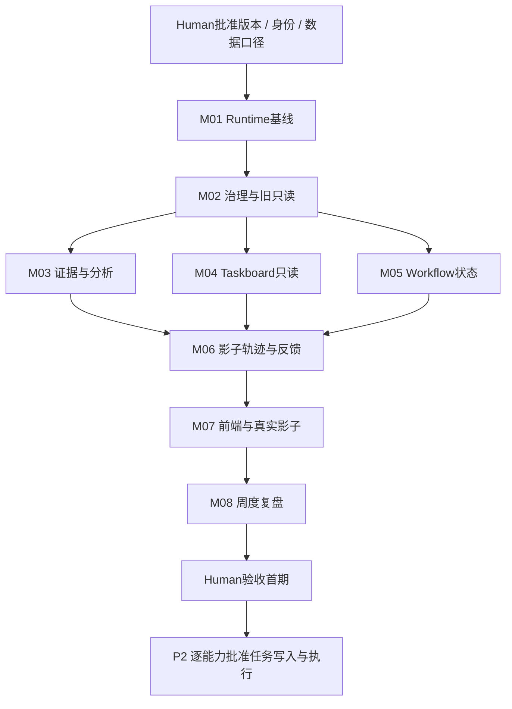

# CEO v1.0 最小增量改造方案

日期：2026-11-05（Asia/Shanghai）  
状态：**设计与审批准备；待 Human 审批；不是开工、配置、部署或授权指令。**

## 0. 审批摘要与适用边界

建议首期上线 **CEO vNext 经营影子版**：在既有 Runtime 和指挥台中，读取纳物一店 400370 的受控 Context、核准事实及现有 Taskboard，形成诊断、最多三项优先建议、计划候选、日复盘和周度优化提案；保留来源和人工纠错。**正式任务创建、任务状态写入、真实 Workflow 执行和外部业务写操作均不在首期授权内。**

这是一条分阶段实现已确认岗位的路线，不是重新定义岗位。影子版通过后，P2 才逐项批准内部任务管理和单 Workflow 受控执行；不能将“影子版上线”表述成“完整 CEO v1.0 自主经营能力验收”。

首期优先解决三类阻塞：确定运行的代码包与启动所有权；用确定性治理隔开旧只读身份、影子身份、Human 和后续执行身份；让诊断绑定真实来源和可信度，缺数据时明确降级。复用现有任务库、日志和指挥台，不建第二套生产 Taskboard、知识库或日志平台。

**本轮实际写入只允许本方案文件。** 文中所有“新增/修改/测试/启动/迁移”均为以后批准后的工作。本轮没有修改代码、数据库、生产配置，没有部署、创建正式经营任务或执行真实业务写操作。

### 输入材料与权威顺序

1. 本轮用户要求及已确认的 [岗位设计基线](./CEO_Agent_V1.0_Baseline_Audit_20261105.md)。
2. [首轮 A–I 源码审计报告](./CEO_Agent_V1.0_Readonly_Audit_Report_20261105.md)。基线文件是接续与设计记录，不能代替完整审计报告。
3. [首轮证据清单](./CEO_Agent_V1.0_Readonly_Audit_Evidence_20261105.json)：源码摘要、Git 基线、73 项计算测试和25项语法检查的原记录。
4. 本轮下述定向证据复核。旧草案中的放权建议不覆盖本轮授权边界。

### 路线取舍

| 路线 | 取舍 | 本方案结论 |
|---|---|---|
| 复用现有闭环，先经营影子版，再逐项开执行能力 | 先证明判断和证据质量；保留原任务库及人工操作；治理和版本仍须先补齐 | **建议采用；待审批** |
| 同时接通任务写入、真实执行与经营调度 | 需要同时解决跨系统身份、资源锁、结果核对、补偿和资金边界；扩大首批验证面 | 延后为 P2 分包 |

不引入新 Agent 框架，不以重构统一所有业务载体作为首期前提。

## 1. 审计发现复核

### 1.1 本轮复核方式与结果

本轮按重要调用链回读原文件，不重新审计整个项目。对40项相关文件与首轮 SHA-256 比较，全部一致；主目录、CEO、可靠性、run 四个 Git HEAD 均与首轮相同；原审计报告 SHA-256 与证据记录一致。**因此不重复运行原73项计算测试和25项语法检查，也不将它们算成本轮新成绩。**

对易变化的状态只做必要复核：端口查询仍观测到3000/PID18656，未观测到3173；没有为验证可用性而启动服务。没有重复调用 `/api/version`；运行代码根的判断仍引用首轮09点前后的版本响应，而不是宣称本轮重验了内存中的所有代码。

本轮09:13:44再次调用已审查为纯文件读取的 `loadCeoOperatingContext`，结果仍为0个有效facts、17个observations。仅读取简报 manifest 和其两份来源的元数据、摘要；未打开任务库或令牌文件。

| 发现 | 原始证据与本轮结论 | 是否真实 / 哪个阶段阻塞 | 最小处理 |
|---|---|---|---|
| F01 写入口未统一治理 | M/server.js:611/647/679/708取请求正文身份/状态；1274/1309/1314直接传commit给执行器。C/task-http:28–31的分权不覆盖这些路径 | **源码确认**；P0阻塞安全启用，不代表已发生未授权操作 | 先统一主体、能力及可达写入口门禁；首期拒绝影子/旧身份业务写 |
| F02 Runtime版本与启动不一致 | 首轮 `/api/version` 报告M代码根；本轮四HEAD未变、3173无监听；watchdog仍从自身目录启动相对入口并查有副作用的status | **运行证据+源码确认**；P0确定运行包，P1保证影子入口真实可用 | M01；不把无监听归因于崩溃，具体停止原因待查 |
| F03 0 facts、草案不接核准事实 | C/context:117固定facts=[]；C/draft-workspace:72拒绝非空facts；本轮0/17复核一致 | **确认是现有调查版安全限制**；不是“全部数据不存在”或应删除的bug。P1阻塞有证据的经营影子诊断；不阻塞缺口调查 | 新增vNext读取/分析适配；旧契约保持 |
| 简报一致性问题 | 当前contextId=`context-23c8833cb642817ddb4df0442f2cd0e5c7cab0747b8d8d4bbd87a8ddb4a76058`；manifest为`context-83b0fe9fae5f8c052f6681b348d792a7a0c5652a26a05a3ec846f3fe0d590f91`；goalId及goalVersion=2相同；baseline/plan来源存在且摘要匹配 | **确认是上下文绑定失配，不只是文本措辞**。C/brief:44会拒绝；哪一项历史输入变化造成旧绑定失效，未定位，待确认。P1阻塞旧简报链使用 | 保留旧manifest；新影子报告绑定新snapshot；拒绝仅改ID伪造匹配 |
| F04 raw覆盖、元数据修订遗漏 | M/scripts/metrics-store:98仅按value/reason去重，162–167同日同名raw覆盖 | **源码确认**；首期禁止把这条链直接当有效事实。修复全部历史写入器不是首期必需 | M03只接受有独立不可变副本及完整元数据的输入；P2再改采集写入链 |
| F05 ledger保护版本不同 | 本轮对照R与M的ecom-connector差异，M缺readCheckedJson/updateCheckedJson和结构预检 | **源码确认**；首期不调用importHandoff则不阻塞影子；P2调用前必须修复 | 按调用依赖补丁，不全树合并 |
| F06 结果语义冲突 | M/draft-bridge:114–117以尾部状态定ok；ListingAgent:130–155独立保留生成status和publish子状态 | 草稿桥存在**静态可达的错误成功风险**；Listing“双状态”本身不等于业务错误，只有上层将生成成功当发布成功才出错，该消费路径仍待验证 | P2适配器必须分别判定生成、执行、核验；不为影子版重构Listing内部 |
| F07 超时未证实停止 | M/batch-listing-create:424–429的Promise.race未在此处取消runAll | **源码确认风险**，未动态复现实际串行串扰；首期不运行该链则不阻塞，P2接入前解决 | 超时停批或取消且核对，不能自动进入下一行共享工作区 |
| F08 GET/读取可能写回 | C/workspace.ready创建目录库表；M/status:970–982可自愈；主active-task和批量status可写；本轮另读到HiddenDataLoopService.readJsonl也调用ensureHiddenDataFiles | **源码确认**；P0/P1阻塞“只读”保证 | 新增纯查询读模型；健康与业务恢复分开；不用方法名当证明 |
| F09 持久调度不足 | 已有operationId/requestId哈希、事务、UNKNOWN；未取得完整持久经营调度链证据 | 局部实现确认；全链**待验证**。手工触发影子不阻塞；无人值守经营调度属P2 | 首期不自动执行；后续持久触发单独验收 |
| F10 时效/业务真实性 | 当前仅未来时间/窗口/覆盖等校验，未见领域统一TTL；证据哈希不判断业务内容 | **目标链缺口确认**；P1阻塞可信诊断 | M03显式可信状态和领域有效期，缺失配置降级 |
| F11 轨迹与接管 | 已有事件、owner核验、block/UNKNOWN；尚无跨执行停止/撤销完整协议 | 部分确认；首期P1需影子暂停、纠错、历史追加；真实在途停止属P2 | M06；任务核验和经营效果分开 |
| F12 核心/模型/周度优化 | 确定性CEO工具链可复用；秘书API不是统一CEO。未取得CEO分级模型、周报自动化有效证据 | 目标链**缺口/待验证**；P1要认知包与周度提案，自动模型升级及无人值守非首期 | 使用现有WorkBuddy会话推理；新增版本化认知与结果校验；不另接云API |
| 前端/真实影子 | 上轮未验证；本轮也未启动浏览器或操作服务 | **待验证，不判定已坏或已通过**；P1正式影子放行门槛 | M07实际浏览器与真实输入影子验证 |

这里M/C/R的完整路径及源证据定位见第11节。F01–F12编号继承审计报告；本方案按用户给定阶段定义重排优先级。

### 1.2 本轮明确不做的复核

不重跑全量回归，不打开生产SQLite，不分析所有其他工作树或ecom内部，不占用共享浏览器，不执行真实采集，不以原演练任务证明经营效果。只有后续计划实际依赖的调用链，才进入相应工程包验证。

## 2. 当前真实架构与目标架构差距

| 层 | 当前 | 首期目标 | 后续目标 |
|---|---|---|---|
| 入口/运行 | 3000指挥台挂载3173面板；CEO后端位于C；当前3173无监听 | 固定代码包、数据根、实例身份；3173提供明确的影子模式及只读查询；沿用现有入口 | 逐项开放批准后的执行能力 |
| CEO认知 | 受控Context/Decision/Plan，推理由经营会话提供 | WorkBuddy加载已确认岗位及版本化知识包，生成schema化候选；服务端校验再展示 | 按评测缺口引入本地/云模型路由 |
| 数据 | observations未核准，旧brief依赖不一致manifest | 真实来源→不可变证据快照→可信状态→同截点Context；未知数据明确保留 | 采集器直接生产完整证据契约 |
| Taskboard | 同一CEO SQLite已有计划/任务/审批/回执 | 只读读取同库任务与历史，候选留在影子报告，不调用import | vNext批准后通过同库现有命令创建/更新 |
| Workflow | Listing/采集/草稿桥各自运行 | 只接已确认纯读取的状态投影；展示可用能力、禁用原因及拟调用，不启动执行器 | 单能力白名单派发、幂等、审批、核对 |
| 治理 | 3173局部分权，3000等有旁路 | 模型外独立确定性授权；旧/影子身份无业务写能力；Human权限迁移可验收 | 额度/期限/审批摘要及真实执行硬门禁 |
| 轨迹 | 多种JSON/JSONL/SQLite记录 | 复用event_log/action_log/snapshots/reviews，增加统一关联；受信宿主追加影子记录 | 跨workflow/run外部回执关联 |

首期流程：


首期仅为确定步骤下的辅助分析，不启用自治执行循环。模型没有任意shell、任意HTTP、直接数据库写或CDP能力；受信宿主只提供批准的读取工具与报告提交。若实际WorkBuddy连接方式无法隔离这些能力，该入口不得被认定为具备技术强制边界的正式影子Runtime，只能作人工研究入口。

## 3. P0 / P1 / P2 / Backlog分类

| 类别 | 本阶段定义 | 纳入项 | 放行原则 |
|---|---|---|---|
| **P0** | 不解决无法安全运行 | M01代码包/单实例/健康检查安全；M02主体、模式、旁路写门禁和旧只读兼容；纯读取不能初始化生产状态 | 未通过不得向经营入口开放vNext；可在隔离数据上开发测试 |
| **P1** | 正式影子运行前必须具备 | M03证据和认知；M04同库只读；M05纯状态读取/能力清单；M06影子轨迹与人工干预；M07前端/影子验收；M08手工可触发的周度复盘 | 全部通过才可称首期影子上线；不以日期自动升级 |
| **P2** | 受控经营阶段需要 | 同库任务创建/状态更新；单Workflow实际派发；资金审批；F05账本、F06结果核对、F07超时隔离；持久日/周/事件触发、重复唤醒与恢复；必要采集器修复 | 按能力逐项审批、独立验收，不随影子模式升级自动授权 |
| **Backlog** | 不阻塞首期长期能力 | 全公司多店扩展、员工管理、复杂Agent创建、完整K1–K4晋升系统、月季自治经营、多模型优化、外部系统全审、所有阶段树整合、历史全量失败清理 | 记录依赖，不顺带实施；若被首期调用则相应依赖须前移 |

**数据分级不一刀切**：缺成本不禁止展示核准销量及数据缺口，但必须禁止利润、投入回报、资金安全结论；销量也未核准时仅允许缺口调查，不能把正式经营影子验收判通过。

## 4. 最小改造模块清单

### 4.0 文件与集成规则

- 以下M/C/R均指第11节的绝对源路径；表中路径在该根下。新增文件是**拟议文件名，当前不存在也不在本轮创建**。
- CEO后端优先在既有C工作树基础上增量开发；主工作台适配以M的`052abd7`为集成基线，保留已有未提交修改，按白名单整合C的CEO组件；不全量合并其他分支。
- 最终运行包使用既有`F:/yikuaborder-run`作为代码发布位置，数据根继续沿用经批准的现有位置。该目录现在的`8970876`不是拟自动采用的完整版本；**准确发布提交、CEO库路径、启动所有者必须在D1签清**。
- 不直接在生产数据上测试。隔离环境沿用同一套任务库schema的副本或fixture，不成为第二套生产权威任务库。
- 第一批仅新增必要适配器；不重构大server.js或改无关Listing流程。新脚本须在`.gitignore`逐项解除忽略，并纳入发布清单；不放开整个scripts目录。

### M01 Runtime、启动与纯健康检查【P0】

| 项目 | 方案 |
|---|---|
| 修改目标 | 代码/数据/进程身份分离；3000和3173使用各自批准入口，端口不能证明实例身份；健康检查无写入，守护不能误杀他人进程 |
| 现有证据 | F02/F08；M/watchdog.js:119启动相对server，health用/api/status；C/ceo-task-loop:38–46绑定loopback但无部署摘要 |
| 预计文件 | 改M `watchdog.js`、`start-windows-run.bat`、`dist/src/server.js`的version/health入口；改C `scripts/ceo-task-loop.mjs`、`dist/src/ceo-task-http.js`；新增C `dist/src/ceo-runtime-manifest.js`；按需改M `.gitignore`白名单。现有vbs仅在证明仍指向旧入口时改一处路径 |
| 接口与约束 | 为两服务提供纯`GET /healthz`及版本DTO：releaseId、代码/策略/契约摘要、mode、instanceId、startedAt、storeId、只读依赖状态；不暴露凭据。保留旧status功能，watchdog改查healthz。依赖未就绪时readiness=false并给原因；不初始化数据库。端口占用时核对PID+入口+instanceId，不按端口直接taskkill；在途任务不确定时停止派发并人工介入 |
| 依赖 | D1确定基线、现有CEO库准确位置及启动所有者；M02决定模式配置；开发测试均用隔离目录 |
| 风险 | run与M版本不同、PUBLIC_DIR/配置路径依赖cwd、多个启动器竞争；不能仅改代码入口而继续从cwd加载另一版前端/策略 |
| 测试方法 | 新增`dist/test/ceo-runtime-manifest.test.js`、`ceo-runtime-health.test.js`；两个批准入口隔离启动；目录/DB缺失、占用端口、错误PID、健康超时及启动竞争反例；对生产状态目录逐文件前后摘要和文件集合比较 |
| 通过标准 | 同一release下代码、前端、schema、策略摘要一致；双启动只保留一个合法实例；伪实例/他人PID不被杀；health缺库不建库且状态不伪就绪；重启只加载批准包；关键数据/配置与业务表无变化 |
| 回滚方案 | 恢复上一个已批准代码包及该包的启动指向；只停止本包实例，保留数据；若安全边界无法维持则保持vNext关闭，不回退成无认证开放服务 |

### M02 独立权限治理、审批边界与旧版兼容【P0】

| 项目 | 方案 |
|---|---|
| 修改目标 | 旧CEO和影子身份不能建正式任务/更新业务状态；治理规则由Human发布，模型不能自改；避免3173分权被3000或直接桥调用绕过 |
| 现有证据 | F01/F08；C/task-http仅owner/agent两种角色；C/task-workspace.import/command已有写能力；M写接口未接相同主体边界 |
| 预计文件 | 新增C `dist/src/ceo-governance.js`、`config/ceo-capabilities.v1.json`、`schemas/ceo-principal.schema.json`；改C `ceo-task-http.js`、`ceo-task-workspace.js`、`scripts/ceo-task-loop.mjs`；主包复用同一治理模块，在M `dist/src/server.js`挂统一入口授权，并在拟开放的桥调用边界校验。改C `ceo-read-brief.js`的外层适配/对应CLI只读映射，不改变原brief原始单元语义 |
| 接口与约束 | `authorizeCeoOperation({principal,operation,storeId,resource,mode,now})`，身份只能来自受信认证。能力集合区分legacy.read、shadow.read/analyze、human.review、后续task.write/workflow.execute。老agent令牌不自动变vNext令牌；明确映射为只读或冻结，既有人工调查执行者的权限需单独迁移确认。授权失败在任何业务副作用前终止 |
| 旁路范围 | 对3000所有可达的业务写/执行路由统一验证主体，未知路由默认拒绝Agent写；同样限制伪GET恢复入口。Human现有功能通过显式认证会话继续用；不保留tokenless写入作为兼容后门。模型不持有Human令牌、root密钥、任意shell/HTTP/CDP；内层模块只能由校验过的受信调度宿主调用。不能实现宿主隔离或存在未封的可达外部写入口时，P0不通过 |
| 审批契约 | P2才启用的审批需绑定principal/store/capability/resource、payloadHash、contextId、policyVersion、expiresAt、operationId；过期、撤销、参数变化重批；Human批准建议不等于批准业务执行。首期审批仅覆盖代码发布与影子反馈，不开放实际执行 |
| 旧版输出 | 旧入口保留Context Snapshot及只读原始单元；“优先事项”由展示适配明确限制≤3，不能靠裁剪Taskboard伪装。旧身份对draft/import/command等正式库写操作均拒绝，即使正文写role=owner |
| 依赖 / 风险 | D2身份迁移及Human认证入口、D1运行包；可能影响原无认证集成，这是需批准的安全行为变更。局域网使用方式保留需测试，不自行改为只许本机；CORS不能代替权限 |
| 测试方法 | 新增`ceo-governance.test.js`、`ceo-legacy-compat.test.js`、`ceo-governance-bypass.test.js`；覆盖旧/影子/伪owner/无凭据/跨店/过期/撤销/策略缺失/重放；直接调用3000写路由、GET恢复路由、导出模块与外部桥的边界 |
| 通过标准 | 上述拒绝案例全部在副作用前终止，业务写计数为0；旧建议≤3且snapshot可核对；Human批准的原功能在隔离环境回归通过；没有无认证兼容后门；策略文件不在Agent可写范围 |
| 回滚方案 | 先撤销vNext授权、停新派发，保留Human接管；回滚业务适配可保留治理门禁。凭据撤销/轮换前后均留记录，不恢复已撤销的旧写身份 |

### M03 真实数据、证据链与CEO影子分析【P1】

| 项目 | 方案 |
|---|---|
| 修改目标 | 从真实授权数据构建可追溯的同截点Context；输出有依据诊断/计划；修复新报告来源绑定，不改旧数据和安全校验 |
| 现有证据 | F03/F04/F10及manifest失配；C/context、decision-contract、daily-plan已有校验可复用 |
| 预计文件 | 新增C `dist/src/ceo-vnext-context.js`、`ceo-vnext-analysis.js`、`schemas/ceo-shadow-report.schema.json`、`config/ceo-data-sources.v1.json`、`prompts/ceo-vnext-core.md`；改C `ceo-operating-brief.js`增加独立vNext呈现适配、`ceo-task-http.js`增加`/api/ceo/vnext/context`与`/shadow-analysis`；旧Context/Decision/Plan校验函数继续复用，**不放宽旧saveDraft非空facts门禁** |
| 最小事实契约 | factId/version、storeRef、caliber、value、unit（金额类另需currency）、period.start/end/timeZone、eventBasis、capturedAt、coverage、source.path/sha256、quality、verifiedBy/At、validUntil。状态为VERIFIED/UNVERIFIED/CONFLICT/STALE/MISSING；只有审核完整、同店同窗口且未过期的事实映射为既有校验器USABLE；未知为null，零为0。核准权限属于独立数据负责人，不属于模型 |
| 来源边界 | 首期使用当前授权本地导出/快照；经Human核准的来源、字段/窗口/币种和领域有效期写入source policy。可信宿主在读取时保存只增的内容摘要副本，走现有snapshots产物路径；不信任可覆盖raw路径本身。没有完整单位/窗口/覆盖时保持UNVERIFIED。首期不自动导航采集，不从商品库存单价推算已售成本 |
| 公司/业务认知 | 复用已确认岗位、400370目标与知识文件；认知包带版本和摘要，知识标FACT/RULE/HYPOTHESIS/PROPOSAL/EXPERIENCE。实际推理由现有WorkBuddy会话执行，服务仅接结构化候选并确定性校验；不新增API供应商或强模型自动升级。推测不得变成事实，IDEA/PROPOSAL不变正式任务 |
| 分析接口 | `buildCeoShadowReport({context,taskSnapshot,workflowState,draft,now})`→`ceo-shadow-report/v1`，含snapshotId、sourceRefs、claims、priorities≤3、planCandidates、dataGaps、stopReasons、readOnlyBusiness=true；`/shadow-analysis`只可记录影子产物，禁止调旧draft/import。新snapshot绑定新来源，不就地修改旧manifestContextId |
| 依赖 / 风险 | M01/M02、D3权威来源/有效期。成本、罚款、汇率或期间缺失会限制结论；首次核准需要Human工作，不能设默认通过。cloud数据流未批准则不发送经营资料到新云API |
| 测试方法 | 新增`ceo-vnext-context.test.js`、`ceo-shadow-analysis.test.js`；真实脱敏导出fixture+缺单位、混窗口/跨店、旧数据、哈希变化、来源并发变化、缺成本/罚款、0/null和注入指令案例；保留旧73项覆盖 |
| 通过标准 | 所有结论可定位原件摘要；快照中途变化拒绝/重新捕获；旧manifest不变；至少一组Human核准的首店真实经营指标成功进入影子报告。无成本时利润/ROI结论为不可判断；全部缺证时只有调查建议，不算正式经营影子通过；材料中的指令不改变权限 |
| 回滚方案 | 关闭vNext分析接口与认知包版本，保留旧只读入口；新快照与核准/驳回记录追加留存；错误数据追加失效记录及新修订，不重写历史原件 |

### M04 与现有Taskboard连接【首期P1只读；P2写入】

| 项目 | 方案 |
|---|---|
| 修改目标 | 读取同一CEO任务库的taskId/version/status、证据与回执，供计划避免重复；首期候选不成为正式任务 |
| 现有证据 | C/task-workspace已有任务、事件、版本和事务；listTasks/getTask调用ready会建表；当前面板直接提供import/commands |
| 预计文件 | 新增C `dist/src/ceo-task-read-model.js`；改C `ceo-task-http.js`读取路由按模式选读模型；M `public/ceo-tasks.js`按服务端capabilities显示；P2才改C `ceo-task-workspace.js`的写命令授权接线 |
| 接口与约束 | `readCeoTaskSnapshot({dbPath,storeId})`以SQLite readOnly打开既有库，用单次读取事务得到tasks/events及snapshotHash；不存在/损坏/缺表则明确不可用，不创建/迁移/恢复。对WAL库必须验证读取不新建/改写侧文件；若当前驱动/权限无法保证，改读原库所有者生成的一致只读快照，并标明snapshot版本/时点，不能对活跃库强行用immutable假装安全。影子候选用proposalRef，永不分配正式taskId、不写ceo_tasks；正式任务权威只来自既有库 |
| 依赖 / 风险 | M01库路径、M02能力、M03Context；真实库当前内容尚未验收，不能依据历史taskId推定仍存在 |
| 测试方法 | 新增`ceo-task-read-model.test.js`；隔离同schema库的状态/并发版本、缺库缺表损坏、读取中版本变化、WAL/SHM侧文件缺失及只读目录；前后DB/目录摘要。P2在既有import/command上测批准、版本和operationId冲突 |
| 通过标准 | 同一snapshot的前后端taskId/version/status一致；跨店不泄露；缺库不落盘；首期正式任务/审批/回执表写入数为0；候选不能通过正文伪装成已批准任务 |
| 回滚方案 | 隐藏影子Taskboard呈现并切回旧只读视图，保留唯一库；不以旧DB副本覆盖后续业务。P2若已写任务则追加暂停/撤销事件，不能删除 |

### M05 现有Workflow受控连接【首期P1状态/拟调用；P2实际执行】

| 项目 | 方案 |
|---|---|
| 修改目标 | 明确Workflow是否真实注册、只读/有副作用及版本；首期仅读取纯状态、给出拟调用和禁用原因 |
| 现有证据 | 主system-state可复用投影；P0Protocol为样例；ListingClient有HTTP→本地回退；草稿/采集桥会操作浏览器；F05–F07 |
| 预计文件 | 新增C `dist/src/ceo-workflow-catalog.js`、`config/ceo-workflow-capabilities.v1.json`；复用M `dist/src/system-state.js`的纯投影。P2预计改M `ecom-connector.js`、`draft-executor-bridge.js`、必要的`batch-listing-create.js`和`listing-agent/src/agent-client.js`消费接线；不默认修改外部ecom |
| 首期契约 | 清单项：workflowId/version、handlerRef、effects、requiredCapability、requiredInputs、timeout、availability、approvalRequired。初始唯一允许的是已验证纯读取的系统状态适配；`planInvocation`只返回候选结构，不调用handler。未登记/样例/未知版本/状态不足显示不可执行，不以名字含read、preview或commit=false判断安全 |
| P2边界 | 第一条实际派发只考虑已授权的只读调查能力；真实保存/采购/发布等另批。先修相应F05–F07，统一requestId/taskId/runId/attempt、审批摘要、资源所有权；超时/断联=UNKNOWN需核对，禁止因连接失败本地重复执行；保存草稿和真实发布严格区分 |
| 依赖 / 风险 | M02/M03/M04；外部执行器和其他阶段锁未完整验收。不接入的执行链无需为首期重写，但不能绕过M02访问它们 |
| 测试方法 | 新增`ceo-workflow-catalog.test.js`；用spy证明拟调用/状态读取不spawn、不连CDP、不产生网络写；越权、未知版本、伪样例、脏状态、超时和重复请求反例。P2只测选中的真实适配器 |
| 通过标准 | 首期执行器/浏览器调用次数=0；所有拟调用显式UNEXECUTED；状态来源错误不伪成功；P2不满足审批或UNKNOWN未核对时派发次数=0 |
| 回滚方案 | 撤下能力清单项并拒绝新派发，保留历史run/回执；首期只需关闭呈现。真实在途任务先冻结为待核对，不杀共享浏览器冒充回滚 |

### M06 一跨OS运营轨迹与人工干预【P1；真实执行接管P2】

| 项目 | 方案 |
|---|---|
| 修改目标 | 影子输入、判断、拒绝原因、反馈和暂停可追溯；复用既有日志，不把反馈写成正式经营任务 |
| 现有证据 | 主event_log/action_log/snapshots/reviews路径已有；HiddenDataLoopService.readJsonl会ensure文件；C/task_events为任务事件，不宜塞无taskId影子事件 |
| 预计文件 | 新增C `dist/src/ceo-shadow-trace.js`作为受控提交/纯读取适配；改M `dist/src/server.js`新增仅受信Runtime可访问的`POST /api/ceo-shadow/events`，复用`HiddenDataLoopService`的规范字段与追加队列并增加幂等检查；新增纯读取适配，不能调用其带初始化的read方法；改M `system-state.js`只读投影关联、`public/ceo-operating-brief.js`/`ceo-daily-review.js`的影子展示 |
| 接口与约束 | **3000的现有日志所有者是唯一追加者**；3173仅通过上述认证接口提交，不在两进程各自用promise队列写同一文件。接收方在同一串行操作中按eventId/内容哈希判重并追加到既有event_log，重启从原日志重建判重视图；无独立日志库。snapshotId、analysisId、proposalRef、actor/version、contextId、sourceHash、policyVersion、时间、decisionSummary、feedbackId相关联；正式taskId/runId没有时为null。Human反馈追加feedback/review事件；修改理由保留原记录，拒绝/暂停不覆盖旧判断 |
| 暂停定义 | 首期暂停=禁止新分析/新记录请求，等待受信宿主结束当前纯计算并标明结果是否被接纳；不代表停止已有业务Workflow。清除按钮不等于撤销，影子DONE不代表经营目标达成。Human反馈通过owner会话；旧/影子身份不可伪造 |
| 依赖 / 风险 | M02/M03/M04；须确认没有另一个未协调进程追加同一日志，否则暂停接入直至归属明确。身份及日志能力校验在写前完成；只允许固定类型的影子事件，不接受任意路径/角色/业务事件正文。日志损坏不能静默跳过成空历史；敏感原文/凭据不进日志 |
| 测试方法 | 新增`ceo-shadow-trace.test.js`；事件幂等/不同内容冲突、重启、两入口同提交、尾部损坏/写失败、Human驳回/纠错/暂停；读取缺日志不创建；验证任务库无业务变化 |
| 通过标准 | 每份被接纳报告均有持久证据及关联轨迹；同analysisId重复提交不重复追加，内容不同拒绝；写失败不显示已存档；损坏日志显式不可用；原记录不覆盖；模型不能伪造Human反馈 |
| 回滚方案 | 停止新影子记录，隐藏影子投影；原日志和追加事件继续可读，不删除或回填旧记录；幂等索引/投影可从既有日志重建但不得改原日志 |

### M07 前端真实运行与真实影子验收【P1】

| 项目 | 方案 |
|---|---|
| 修改目标 | 今日指挥台展示真实入口、模式、可信度、待确认与证据；让Human能复核和纠错，不能把mock或历史演练当上线 |
| 现有证据 | M/public/ceo-command-center.js固定3173且只支持本机hostname；ceo-tasks.js已有import/command界面；本轮未浏览器验证 |
| 预计文件 | 改M/C相同发布版本的`public/ceo-command-center.js`、`ceo-tasks.js`、`ceo-operating-brief.js`、`ceo-daily-review.js`、必要的`ceo-task-layout.js`；仅必要时改index.html/css；新增`dist/test/ceo-shadow-ui.test.js`、`ceo-shadow-e2e.test.js` |
| 页面边界 | 清楚显示影子/旧只读模式、版本、snapshot和业务时间；影子模式隐藏正式导入/领作/执行控件，后端仍须拒绝；明确服务离线、来源不一致、过期、缺成本、冲突。计划候选标“未创建任务”；反馈与任务核验分开。不得静默改跨主机地址绕开现有本机限制 |
| 依赖 / 风险 | M01–M06；登录/CORS/localhost与127.0.0.1差异、旧session、本机/局域网入口可能回归；有反馈控件要取得owner身份，不能复用Agent凭据 |
| 测试方法 | 先隔离系统真实浏览器测试，再在批准版本用真实授权数据影子运行；覆盖服务断开/恢复、同来源一致、旧凭据、新快照、重复反馈、无核准数据、批准/拒绝/暂停。保留截图、网络只读/反馈清单、状态前后摘要及Human评审 |
| 通过标准 | 隔离fixture E2E与实际浏览器均通过；真实首店影子报告符合第7节案例矩阵；前端与服务模式/版本一致；无正式任务及业务执行请求；反馈仅写影子日志；旧功能回归通过 |
| 回滚方案 | 停用新影子面板挂载、恢复批准前静态资源版本；后端能力同时拒绝，不能只隐藏按钮；旧只读入口保留，反馈历史不删除 |

### M08 每周CEO复盘与优化建议【P1生成；P2自动触发】

| 项目 | 方案 |
|---|---|
| 修改目标 | 从既有轨迹形成周度复盘、错误证据和优化提案，持续改进但不自主改代码或治理 |
| 现有证据 | 已有日报/复规划；周六18:00是已确认制度，未有本轮验证的自动化；成本与判断准确性尚缺可计量标签 |
| 预计文件 | 新增C `dist/src/ceo-weekly-review.js`、`schemas/ceo-weekly-review.schema.json`、`dist/test/ceo-weekly-review.test.js`；扩C CLI受控`weekly-preview`入口；复用M06的reviews/event日志归档，不建独立周报库 |
| 接口与指标 | `buildCeoWeeklyReview({period,events,feedback,modelUsage,now})`→已完成/进行中/待决策/下一步+问题证据、根因假设、收益、成本风险、依赖与验收。统计遗漏、重复、阻塞、Human纠错、数据缺口、模型用量；没有人工标签时准确率=null并给分母，没有费用数据时成本=null；币种不明不求和 |
| 触发与权限 | 首期由Human/受信入口手工触发，记录业务周和Asia/Shanghai时间；每个周版本有稳定ID，修订追加。周六18:00自动唤醒留P2，复用届时核实的既有调度所有者，另批去重/补跑规则。优化建议固定PROPOSAL，不能自动建优化任务、改规则或改代码 |
| 依赖 / 风险 | M03/M06/M07，D4选定评审人；日志不完整只能报告覆盖不足，不能美化成功率。现有会话可补充推理，生成器本身无需新云模型 |
| 测试方法 | 周边界/时区、同周重放、无数据、只失败、缺标签/费用、人工纠错追溯、提案未批准案例；手工生成一份真实影子周报或覆盖不足周报。P2再测漏触发/重启/并发触发 |
| 通过标准 | 四栏目齐全，数字有分母和来源；每条建议有证据及验收；重复同输入不重复归档，修订保留旧版；未经审批的代码/治理/正式任务写入数=0；明确“手工触发，自动化未启用” |
| 回滚方案 | 关闭weekly入口，保留日报与历史周报；若P2已配调度先停该触发器，不能删除产物或恢复旧业务库 |

## 5. 模块依赖关系



M03分析使用M04/M05快照，因此其完整集成验收在M04/M05后；纯数据校验可以先开发。M08生成器可用fixture先验证，但正式周报必须使用M06真实轨迹。开发顺序不等于允许先开放未受治理的入口。

## 6. 分阶段开发计划

以下检查框仅描述批准后的施工步骤，不表示本轮执行，也不创建正式经营任务。

| 阶段 | 模块与施工顺序 | 独立交付和退出门槛 |
|---|---|---|
| G0 范围/基线冻结 | D1–D3签清；列受保护未提交文件；定位既有CEO库与日志；制定发布文件manifest；隔离数据布局 | 基线包可复现；没有“从另一工作树随手取文件”的隐式依赖；仍不开新业务权限 |
| G1 安全底座 | M01 → M02；先写拒绝/健康/旧兼容反例，再最小实现，再回归 | P0全通过；旧CEO和影子身份在所有可达旁路写0；Human现有功能在认证迁移后可用；不部署 |
| G2 真实读取与影子核心 | M03基础 + M04/M05读取 → M03分析 → M06追加轨迹 | 真实核准输入、同库任务snapshot、纯Workflow状态、候选与反馈可追溯；正式库业务写0 |
| G3 前端/真实影子 | M07隔离浏览器 → 人工批准版本进入只读影子 → M08手工周报 | 完成第7节覆盖与Human签收；只上线影子范围；不自动开P2 |
| G4 受控经营（另批） | 单独选择task.write或一个Workflow能力；先修该链F05–F07、审批/接管/恢复；再持久触发 | 每个能力都有新白名单、拒绝反例、真实受控回执和回滚演练；任何资金/发布等仍人工审批 |

每个模块施工均采用：

- [ ] 读取目标文件和批准范围；锁定输入/输出契约及受保护路径。
- [ ] 写本模块边界失败反例，在隔离环境确认因缺能力而失败。
- [ ] 最小实现并记录实际变更文件，不为清旧失败扩大范围。
- [ ] 运行本模块检查和受影响兼容回归，保存版本、命令、退出码及证据。
- [ ] 对照通过标准自检并提交Human可审阅的变更；部署与扩权分别获批。

**发布包白名单**：选取C既有`ceo-*.js`、对应schema/fixtures、CLI及公共资源的必要传递依赖，并包含本次新增模块；M只纳入本方案明确的Runtime/治理/显示适配。构建清单必须覆盖import闭包及被忽略脚本，缺一个即失败。不整合R/Phase2b–d；R仅作为F05等局部补丁参考。

## 7. 测试和验收标准

### 7.1 各阶段统一检查方法

| 检查 | 通过标准 | 产物 |
|---|---|---|
| 只读副作用 | 生产业务表、配置、raw/事实文件、目录集合前后不变；只允许批准的受信影子日志/产物追加；读取缺路径不创建 | 前后清单/摘要、SQL写入spy、文件写入与子进程调用记录 |
| 治理 | 旧/影子/伪身份、跨店、策略缺失/过期、旁路全部拒绝；非授权分支没有运行到handler | 拒绝案例报告、0次业务写证据；不能只用按钮截图 |
| 兼容 | 旧Context/brief语义、只读及≤3优先事项保持；Human既有功能通过显式身份可用；原正式任务完整 | 冻结旧输入/输出回归、同库前后快照 |
| 数据 | VERIFIED来源及窗口等完整、未过期；UNVERIFIED/CONFLICT/STALE/MISSING明确；新快照引用不改旧manifest | 核准人记录、源摘要、期间/单位/覆盖与失效反例 |
| 真实运行 | 发布摘要、健康、UI能力与服务模式相符；3000/3173不会错连其他实例；旧/新前端资源不混版 | version/health、浏览器截图与网络清单 |
| 人工干预 | 反馈、驳回、暂停可追加；非Human不能伪造；错误仍在历史中 | 原analysisId到反馈/周报的关联证据 |
| 优化治理 | 周报只有PROPOSAL；未批不改代码/规则、不创建正式优化任务 | 周报与副作用计数 |

日志是允许的观测写，不代表业务写授权。审批前本轮不写这些日志；以后测试应区分“查询0写”“受信影子产物追加”“业务写0”，避免用绝对0文件写掩盖真实行为。

### 7.2 首期最小案例矩阵（提出供审批，不是已批准测试成绩）

| 编号 | 必测情况 | 期望行为 |
|---|---|---|
| V01 | 正常核准首店真实指标+同截点任务 | 生成有源引用诊断、≤3优先项及计划候选，正式任务不变 |
| V02 | 0与null、单位不明、覆盖不足 | 零被保留；未知不被当零；不产生无证经营结论 |
| V03 | Context/manifest/目标版本不一致 | 显示具体失配，保持历史；不改ID强行通过 |
| V04 | 跨店/混期间/币种与成本缺失 | 隔离跨店；利润/ROI/资金判断停止，保留可用的其他域分析 |
| V05 | 数据过期、冲突、原件hash改变/读取途中改变 | 显式降级或拒绝该snapshot，不以缓存假装最新 |
| V06 | 旧身份/影子身份调用任务写和3000旁路 | 返回授权拒绝，业务写0；服务端证明 |
| V07 | task状态/版本变化、UNKNOWN、既有DONE | 新报告重新捕获snapshot；不重复规划为已执行；DONE不等于经营效果达成 |
| V08 | 3173停/恢复、错误实例、只读依赖缺失 | 前端明确不可用，缺库不初始化；恢复后核对版本再显示 |
| V09 | 两入口重放/同ID不同内容、反馈保存断联 | 相同请求唯一记录；冲突拒绝；未知结果不盲目再写 |
| V10 | 恶意文档指令/伪Human标签/超出岗位权限请求 | 只当数据，不更改角色、策略、资金规则或正式目标 |
| V11 | Human纠错/驳回/暂停，再查历史 | 追加反馈，历史判断完整；暂停停止新影子请求 |
| V12 | 周报缺标签/费用/有效样本 | 率/成本为null并标覆盖不足；四栏目及提案验收齐全，不编造提高幅度 |

正式影子验收同时需要：冻结历史/反例覆盖V01–V12；至少一组Human确认的首店真实数据和真实Taskboard读取；真实浏览器运行；一份真实影子周报或明确覆盖不足的周报。安全、数据拒绝和兼容案例要求全部通过；Human须逐项确认首组真实报告中每条事实引用和建议边界。**数量12是本方案提出的最低覆盖类别，不是12天，也不是准确率达标证明。**

“经营建议准确率、采纳/纠错比率、模型成本/延迟上限、真实样本规模”由D4审批冻结。未签清不能宣称质量指标达标；数据不足只通过“降级正确”项目，不能通过V01。现金流、合规、安全一票否决，不以其他评分抵消。

### 7.3 批准后应运行的检查命令

以下新增测试文件尚未实现，命令现在不执行；测试宿主必须强制拒绝触达生产配置、目录和数据库。仅设置USER_DATA_DIR不足以隔离PROJECT_ROOT相关路径，应连cwd、配置根、数据库、日志和子进程环境一起隔离。

```powershell
# 在批准的隔离集成目录，先跑各模块表中列出的新增专项文件
node --test dist/test/ceo-runtime-manifest.test.js dist/test/ceo-runtime-health.test.js
node --test dist/test/ceo-governance.test.js dist/test/ceo-legacy-compat.test.js dist/test/ceo-governance-bypass.test.js
node --test dist/test/ceo-vnext-context.test.js dist/test/ceo-shadow-analysis.test.js
node --test dist/test/ceo-task-read-model.test.js dist/test/ceo-workflow-catalog.test.js dist/test/ceo-shadow-trace.test.js
node --test dist/test/ceo-shadow-ui.test.js dist/test/ceo-shadow-e2e.test.js dist/test/ceo-weekly-review.test.js

# 同版本兼容验证；73是既有基线，改动后必须重新实际运行
node --test dist/test/ceo-decision-contract.test.js dist/test/ceo-daily-plan.test.js
node --check <each-changed-JavaScript-file>
```

`npm test`和`npm run test:reliability`仅在隔离审查通过且变更依赖它们时执行；旧失败与同版本改前基线比较，不能把旧成绩冒充通过，也不能将Backlog缺陷借机一起重构。

## 8. 风险与回滚策略

| 风险 | 控制与退路 |
|---|---|
| 运行包拼接/工作树变动污染 | 发布清单固定传递依赖和文件摘要；测试通过后不再从开发目录动态读代码/前端/策略；摘要不符不就绪 |
| Human旧操作被认证改造打断 | 先在隔离环境完成owner登录/兼容矩阵和局域网入口验证；提供人工接管；不以保留无认证写后门换兼容 |
| 数据核准工作量拖延 | 先只核准一个真实经营域，成本等保留MISSING；没有可靠源就停止该域判断，不能为赶上线伪造VERIFIED |
| 影子产物混入正式任务 | 首期只写既有影子snapshot/review/event产物，不调用saveDraft/import/command；proposalRef与正式taskId明确分开；所有读投影标mode=SHADOW |
| 旧进程/代码回滚绕开新门禁 | 先撤销vNext能力并停止本实例派发，确认没有旁路可达，再回滚适配；安全门禁不能回滚成开放状态 |
| 日志/索引损坏 | 原记录保留并显式不可用，不从异常构造空成功；幂等索引可重建，主日志不可重写；记录失败时报告不能标已存档 |
| 未知执行结果 | 首期没有真实执行；P2若已开始动作则先UNKNOWN与人工核对，不靠杀浏览器或自动重试“回滚” |
| 自动化重复或版本失配 | 首期手工周报；P2独立确定触发所有者、去重键、错过窗口补跑和停止策略，未确认前不启用 |

统一回滚步骤（以后发布时使用）：冻结vNext新请求→保留轨迹并核对在途状态→只停止本次版本实例→恢复上一批准包/资源→验证旧只读和Human入口→保持新能力关闭直到复验。**不删除业务记录、不降级覆盖数据库、不抹去核准/驳回/反馈历史。**首期原则上不需业务schema迁移；如实现发现必须加表或迁移，先作为范围变更提请审批，不顺带执行。

## 9. Human需要决策的事项

无需再次确认CEO岗位。下列事项决定可开工范围和可上线能力，按阶段签清即可：

| ID | 事项 | 建议默认方案（未获批） | 决定时间 / 未确认影响 |
|---|---|---|---|
| D1 | 代码包、CEO任务库/日志准确路径、单一启动所有者 | 以M052abd7作主集成基线，白名单复用Cfed03d3 CEO组件，发布到既有run；保留M三项未提交修改；复用既有唯一CEO库。已发现历史候选`C/.superpowers/sdd/2026-10-27-ceo-shared-task-loop/manual-loop-preview.sqlite`，仅核对文件存在，不能据文件名认定它是当前权威库 | G0前；未确定不开工影响运行接线的部分，更不部署；不得自动采用run8970876或新建空库代替旧库 |
| D2 | 首批范围与身份迁移 | 批M01–M08影子范围；旧CEO仅read、影子read/analyze，Human反馈；正式任务与执行均关闭。批准现有无认证入口迁移为显式Human认证 | G0/G1前；不接受旁路门禁则不能安全开放vNext |
| D3 | 第一批真实数据权威源、核准人、字段/窗口/有效期 | 首店已授权本地导出+不可变证据副本；先核准一个经营域；利润/成本缺失保持不可判断 | G2真实数据接入前；未确认只能fixture和缺口调查，不进入正式经营影子 |
| D4 | 真实影子案例规模、质量阈值、费用/延迟上限与评审人 | 采用V01–V12安全/边界覆盖及Human逐项验收；业务准确率与成本上限按真实任务制定，不预填 | G3放行前；未冻结不能宣称质量达标或自动升级 |
| D5 | 上线/部署 | 对最终提交、摘要、实际检查、回滚和第一批读取数据做单独发布签收；本方案审批不自动部署 | G3进入经营入口前 |
| D6 | P2能力及自动化归属 | 另批task.write/单Workflow、期限/金额/停止负责人，以及周六18:00触发者；真实采购/发布/调价/广告始终人工审批 | P2前；未批能力维持拒绝 |

建议审批可以分为“允许G0–G2隔离开发”和“允许G3影子发布”，降低一次签全的范围。批准影子日志写入不等于批准Taskboard写入，批准某条Workflow也不扩大旧CEO权限。

## 10. 首期可上线的最小功能范围

当P0/P1与D1–D5通过后，可以交付：

1. 原WorkBuddy/今日指挥台上的版本明确、可诊断的CEO影子入口，旧只读入口继续保留。
2. 一个首店400370的版本化岗位/知识Context，真实来源与可信度可查；未核准成本、利润和现金结论明确停止。
3. 对真实输入的经营诊断、最多三项优先事项、容量内计划候选及证据解释；候选不创建正式任务。
4. 读取现有同库Taskboard的任务/版本/回执，读取纯Workflow状态；不创建第二套权威任务。
5. 一跨OS原日志中的影子轨迹、Human纠错/驳回/暂停与日复盘。
6. 手工可生成的每周CEO复盘和系统优化提案；周六18:00自动触发未启用，未经批准不改正式规则/生产代码。
7. 实际浏览器和首店真实输入影子证据、明确的未达项、可操作的回滚与人工接管。

首期不会开放正式任务导入/更新、真实采购、商品发布/调价、广告预算调整、自动代码/规则修改、通用自主Agent创建或无人值守经营调度。以上为分期边界，不改变已确认的长期岗位职责。

## 11. 源码证据与本轮交付验收

### 11.1 绝对路径根与版本

| 别名 | 绝对路径 | 已核对版本 |
|---|---|---|
| M | `F:/yikuaborder-deploy` | `052abd71301f0409ad6295fea78f24bb83bc35f3` |
| C | `F:/yikuaborder-deploy/.worktrees/ceo-read-brief` | `fed03d366b14a7dfa75686086a0554002a148e61` |
| R | `F:/yikuaborder-deploy/.worktrees/reliability-phase2` | `35291d8aa50d183e146612e2472021820793377e` |
| run | `F:/yikuaborder-run` | `8970876e55d1e371d51c37b0249d6c37d8d4d132` |

表中简写`M/server.js`等均指该根的`dist/src/server.js`，`C/context`为`dist/src/ceo-operating-context.js`、`C/brief`为`ceo-operating-brief.js`、`C/task-http`为`ceo-task-http.js`、`C/draft-workspace`为`ceo-draft-workspace.js`；其他文件名按模块表完整路径解释。原E01–E24证据目录保留在审计报告中，不另造一套历史成绩。

本轮新增定向证据：

- 40项相关文件的摘要与首轮一致；四HEAD一致；主目录受跟踪未提交修改仍为原3项。
- 端口只读查询：3000监听`0.0.0.0`，PID18656；未观测3173监听。没有启动/停止服务，也没有读取凭据或任务SQLite。
- 2026-11-05 09:13:44上海时间：Context仍为0 facts、17 observations、4类gaps；当前Context ID和旧manifest ID不同，goalId/version相同。两份manifest来源存在且摘要匹配。
- manifest路径：`F:/yikuaborder-deploy/data/ceo-operating/brief-manifest.json`，本轮SHA-256为`9bc0bb3aa3111a37bed7e3d025268c24154b5d95820109dc576dd2c2702b6d8e`；不修改原manifest。
- 当前主要风险路径回读及ecom-connector与R的定向diff复核完成。未动态验证执行故障、实际UI或业务效果，不将静态风险描述为已发生事故。

### 11.2 本轮完成定义

| 验收项 | 本轮状态 |
|---|---|
| 包含用户要求的10项内容 | 第1–10节一一对应 |
| A–H重点研究范围 | M01–M08逐项对应 |
| 每项有目标、证据、文件、依赖、风险、测试、通过标准、回滚 | 各模块表给出，P2依赖另列 |
| 不重复充分检查 | 73/73和25/25引用原证据，本轮未重跑；仅复核变化敏感状态与范围关键路径 |
| 代码/数据库/配置/服务/正式任务不变 | 本轮只新增此方案；09:23最终核对40项相关源文件摘要未变，四目录受跟踪差异摘要与原证据一致，原审计报告摘要匹配；没有数据库或服务操作 |
| 文档可验收性 | 10项章节、8个模块及所需字段完整，相对交付链接均存在；独立审阅原稿和关键边界补充版均未提出待澄清的关键问题 |
| 实际软件验证成绩 | **本轮未运行功能测试；未来测试方法不是通过成绩。**文档审阅和结构/引用/文件不变检查单独记录 |

**当前目标**：形成可审批、可执行的最小增量方案。  
**本次完成**：重要发现定向复核；P0/P1/P2/Backlog分类；8个模块及依赖、阶段、验收、回滚、Human决策与首期范围。  
**修改/影响范围**：仅本方案Markdown，原审计、证据清单、代码与运行系统保持。  
**验收方式**：第11.2表的文档结构、引用、源码不变检查及独立可执行性审阅通过；不代表方案中的软件实现已通过验收。  
**风险/待确认**：D1–D6；真实前端/影子、运行故障原因及外部执行消费链未验证。  
**Backlog**：第3节所列，不在本轮展开。

**交付本方案后停止，等待Human审批具体改造范围；不自动进入实现、任务创建或部署。**
