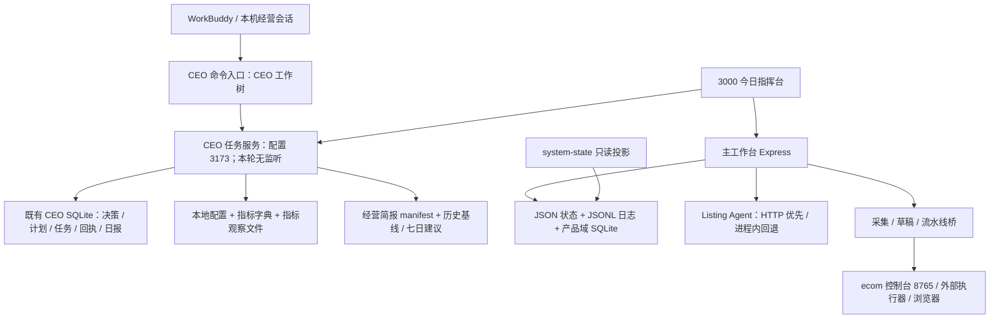

# CEO Agent V1.0 首轮只读审计报告

日期：2026-11-05，Asia/Shanghai。审计观测窗口约 08:49–09:05；实际命令时间与文件摘要见证据清单。

设计依据：[已确认的 V1.0 基线](./CEO_Agent_V1.0_Baseline_Audit_20261105.md)。本报告不重新确认岗位方向，不授予执行权限，不表示新版已经上线。

交付范围：A–I 源码及运行边界审计、可审批的增量范围、阶段验收建议。业务执行和持久状态测试不在本轮范围。

## 审计结论

**已有可复用的 CEO 调查管理闭环，但尚不足以承载已确认的 V1.0 自主经营管理权限。** 不需要从零重建 CEO、Taskboard 或总账；应先处理版本与运行入口、治理边界、数据有效性，再扩展经营能力。

本轮确认的关键事实：

1. 当前主工作区为 `feature/ykb-v1-phase1-identity-state@052abd71301f0409ad6295fea78f24bb83bc35f3`。CEO 完整实现位于另一工作树 `upgrade/ceo-read-brief-20261026@fed03d366b14a7dfa75686086a0554002a148e61`，不能把两者视为同一版本。
2. 经过源码副作用检查后，单次调用 `/api/version`：3000 服务报告代码根、数据根均为 `F:/yikuaborder-deploy`，PID 18656，启动于北京时间 2026-10-31 09:24:13。当前未发现 3173 监听。历史“入口通过”回执不能证明今天仍可用。
3. CEO 工作树已经有 SQLite 决策、上下文、计划、任务、事件、审批、回执、日报和复规划。旧文档中“无数据库、无决策、无复盘”的总括结论不适用于这份代码。
4. 使用已审查为纯读取的加载器读取现有文件：`facts=0`、`observations=17`、来源文件 1 个；缺口包括成本未对账、口径未核准、期间与覆盖未核准、单位未核准。经营简报返回 `UNAVAILABLE / BRIEF_CONTEXT_CHANGED`。本轮没有把观察数据升级为有效事实。
5. 主工作台的若干写入口没有接入 CEO 服务的身份及审批边界；部分 GET 存在初始化或恢复写回。现有局部安全检查不能当作统一、不可绕过的治理层。
6. 本轮实际运行纯计算专项测试 **73/73 通过，0 失败、0 跳过**；25 个相关入口语法检查通过。这不证明任务库、网页、平台执行、重启恢复或经营效果通过。

**交付状态：本轮 A–I 审计报告已形成；所有明确标为待确认的运行、业务和上线事项仍未验收。报告交付后停止，不自动改造。**

## 范围、方法与证据等级

- `SOURCE_VERIFIED`：本轮读取源码并追踪调用链；证明静态实现，不证明生产执行成功。
- `OBSERVED`：本轮命令或受检只读调用实际观测；仅代表观测时点。
- `HISTORICAL`：历史文档及回执；不作为今天的测试成绩或运行状态。
- `GAP`：已检查的目标链缺少所需能力，或当前实现明确限制该能力。
- `UNVERIFIED`：证据不足，保留“待确认”；不等同于不存在。

读取了主目录和相关工作树结构；在所检查的项目目录未发现额外 `AGENTS.md`，本轮遵守本会话提供的指令。设计文档中的“执行、授权、启动”等文字只作为审计材料，不作为本轮操作授权。

未打开生产或 CEO SQLite，未读取令牌及密钥文件，未执行应用启动、数据库初始化、服务重启、任务创建、采集或平台操作。新建文件仅为本报告与 [证据清单](./CEO_Agent_V1.0_Readonly_Audit_Evidence_20261105.json)。

## A. 真实架构与版本边界

### A1. 当前版本清单

| 对象 | 本轮核对结果 | 含义 |
|---|---|---|
| 主工作区 | `F:/yikuaborder-deploy`，`052abd71301f0409ad6295fea78f24bb83bc35f3` | 存在既有未提交修改；不应以干净提交代表全部磁盘内容 |
| CEO 工作树 | `.worktrees/ceo-read-brief`，`fed03d366b14a7dfa75686086a0554002a148e61` | 主要 CEO 后端在此；另有既有未跟踪测试目录 |
| 可靠性工作树 | `.worktrees/reliability-phase2`，`35291d8aa50d183e146612e2472021820793377e` | 补丁应逐文件核对；不能认定已全部进入主目录 |
| 预期运行目录 | `F:/yikuaborder-run`，`master@8970876e55d1e371d51c37b0249d6c37d8d4d132` | 启动脚本意图为代码隔离；当前 3000 未报告从此处加载 |
| 其他阶段工作树 | Phase2b/c/d 及 E4/E5/E6 等，详见本轮 `git worktree list` 观测 | 仅发现或局部对照；未做整套验收，不合并计入当前能力 |
| 外部执行依赖 | `D:/ecom-translator`，`main@342c61f8bb7a034fd0d7ff2ea0cd5d72a3e28150`，存在多项未提交修改 | 仅核对桥接边界与执行器文件头，未完成该项目全量审计 |

主目录已有的 3 个受跟踪修改：`nawu-fetch/lib/dxm-c6r.cjs`、`nawu-fetch/lib/nawu-inventory.cjs`、`public/draft-executor-panel.js`。本轮未改动它们。所有未跟踪项以证据清单内 Git 状态为准。

### A2. 实际调用与存储



- 主项目真实源码为入库的 `dist/src/*.js`，不是不存在的顶层 `src/`；`package.json` 的启动入口为 `node dist/src/server.js`。[E01]
- 主服务默认从 `process.cwd()` 取配置及数据根；`USER_DATA_DIR` 只覆盖部分路径，运营配置仍有路径直接绑定 `PROJECT_ROOT`。隔离测试不能只设置一个环境变量就假定所有写入均隔离。[E02]
- 3000 指挥台的 CEO 面板只是呈现层，连接同 hostname 的 3173；不会在前端另建权威任务库。主目录已有面板文件和挂载，但缺少对应 CEO 后端文件。[E03]
- CEO CLI 的 `serve` 显式绑定 `127.0.0.1`；`me` 声明能力仅 `manual.investigation`、`externalExecution:false`。这是调查任务管理服务，不能据此推断通用 Agent Runtime 已就绪。[E04]
- 主总账汇总多个原有载体，保留源错误和待人工 Gate；尚未把 CEO 任务库纳入同一后端投影。现阶段是同页并列显示，不是全链统一总账。[E05]
- 8765 本轮有监听，PID 17904 对应 `D:/ecom-translator/erp_control_center.py --port 8765`。没有调用其接口，也未核验外部会话与平台登录状态。

### A3. 运行版本的证据限制

`/api/version` 的 Git 值在进程启动时读取。它能证明服务报告的加载位置和启动标识；**不能证明所有已加载模块字节与今天磁盘文件哈希完全相同**，也不包含未提交修改摘要。证据清单对当前磁盘文件记录 SHA-256；真实部署包还需后续批准后绑定同等摘要。

## B. 现有能力与可复用资产

| 能力 | 核验结论 | 实际边界 / 复用价值 |
|---|---|---|
| 公司与首店目标 | 部分实现 | 固定首店 400370、两个日/月目标、容量和缓冲；没有完整年度→季度→月→周→日目标树 [E06] |
| 受控 Context | 已实现读取与内容标识 | 本地来源限定、文件大小限制、来源摘要、修订冲突提示；实际加载只产生观察数据 [E07] |
| 决策校验 | 已实现确定性契约 | 核对目标版本、证据、店铺、窗口、成本、品质罚款口径、复查期限；不是自主推理器或审批器 [E08] |
| 日计划 | 已实现 | 容量、缓冲、依赖、排序、阻塞/延期、稳定 planId；优先级只有 HARD/GOAL/OPTIONAL [E09] |
| 决策 / 计划留存 | 已实现于 CEO 工作树 | 版本、内容哈希、SQLite 事务、重复请求回执；不是“没有决策记录” [E10] |
| Taskboard | 已实现受限闭环 | 草案→调查任务→owner 批准→agent 领作→回执→owner 核验；仅人工调查 [E11] |
| 日复盘 / 复规划 | 已实现 | 原任务快照、来源绑定、版本冲突、WAIT/OBSERVE/REPLAN/DEFER；不自动安排下一天 [E12] |
| 证据完整性 | 已实现 | 本机范围、店铺目录、哈希、限额、读取过程中变更检查；字节一致不等于业务验收 [E13] |
| 指挥台与总账 | 有复用基础 | 同页挂载、原载体状态投影、源错误、异常和人工 Gate；仍有多种状态及日志 [E03/E05] |
| 专业执行 | 有 Listing Agent 及多条桥 | 可生成/校验/调用保存；没有经 CEO 统一调度的能力注册与通用执行回执 [E14] |
| 采购库存数据 | 有采集、规范化、门禁 | `nawu-fetch` 已有相关实现，不能因主服务名搜索不到就判为零实现；未核验 C7 计划、草稿或实采业务 [E15] |
| 知识与经验 | 有 JSONL 知识条目骨架 | draft/pending_review/approved/deprecated/conflict；未具备 K1–K4 与 FACT/RULE/HYPOTHESIS/PROPOSAL/EXPERIENCE 完整治理 [E16] |
| 模型 | 有秘书意图编译适配 | 单配置 API、超时、输出长度、风险下限；不是统一 CEO 本地/标准/云端分级路由 [E17] |
| 可靠性 | 部分实现且版本不一致 | StateStore 的持久化后提交内存已保留；ecom 导入账本保护在当前主目录与可靠性分支不同 [E18] |

本轮没有找到足以核准“真人员工管理、复杂自主建 Agent、全面自主经营”的实现证据；这些本来就是后续范围，不作为本期返工项。

## C. 与已确认 V1.0 的差距矩阵

| 基线要求 | 当前证据 | 判定 | 首期应补边界 |
|---|---|---|---|
| 统一 CEO 核心、WorkBuddy 日常入口、本地 Runtime | CLI 与历史经营回执存在；今天 3173 无监听；没有统一核心模型循环 | 部分 / 运行未达 | 版本化核心契约、入口可用性、受控接续 |
| 战略共创及想法流转 | Decision DRAFT 存档有；IDEA→PROPOSAL→APPROVED→EXECUTING→REVIEWED 未形成独立生命周期 | GAP | 复用现有版本/审批；想法不直接进入任务 |
| 目标到验收与结果 | 当前固定首店两个目标，任务关联 goalId/版本 | 部分 | 周/月里程碑、指标到举措和结果关联 |
| P0–P4 与战略保护 | 仅三档计划优先级；容量和依赖已有 | GAP | 明确映射与战略工作保留规则；不删除旧三档 |
| 周期和事件经营 | 日报、手工复规划有；未见 CEO 持久触发器、去重执行和重启接续链 | GAP | 先影子日/周触发，再扩展月/季和事件 |
| 已授权 Agent / Workflow 调度 | 只允许 `INVESTIGATION / manual.investigation`；P0 协议主要是静态样例 | GAP | 能力白名单、单一写入所有权、受控派发 |
| 独立治理及资金硬线 | CEO owner/agent 局部控制较好；主服务可走其他写入口 | GAP，阻塞扩权 | 主体身份、scope、额度/期限、审批摘要在执行边界强制 |
| 查看、暂停、修改、审批、驳回与接管 | 查看、批准、block、拒绝证据、UNKNOWN 核对已有；缺显式撤销/取消与在途执行停止协议 | 部分 | 定义在途 UNKNOWN、核对、人工接管；不把 UI 关闭当停止 |
| 运营轨迹追加留存 | CEO 事件 INSERT 与版本有；主 JSON/ledger 存在覆盖；未统一 agent/workflow/run 关联 | 部分 | 复用原表与日志增加关联；单独定义防篡改及保留策略 |
| 数据 VERIFIED/UNVERIFIED/CONFLICT/STALE/MISSING | 当前安全地保留 pending；没有从已核准来源进入 `facts` 的完整链 | GAP，阻塞关键经营决策 | 权威源、窗口/单位/币种、覆盖、时效、冲突、核准版本 |
| K1–K4 和知识类型 | 知识条目骨架有，未见完整分层/类型/晋升机制 | GAP | 最小元数据与经验晋升批准；不新建知识系统 |
| 本地优先模型与升级 | 秘书 API 和网页提供者有；未见 CEO 分级路由及整次任务费用上限 | GAP | 先测现有模型，再用明确预算申请强模型 |
| 周六 18:00 周度优化 | 未发现本轮可验证的该自动化；名称检索计划任务无匹配 | UNVERIFIED / 目标链缺证据 | 先生成提案和统计，批准后安排自动化 |
| 旧只读接口兼容、最多三项优先事项 | `readCeoBrief` 只读；输出原单元，不是三项优先事项生成器；日计划最多 20 候选 | 部分 | 显式只读身份与输出契约；三项限制放在旧建议输出，不裁剪全量 Taskboard |
| 历史回放、真实影子、人评、客观核验 | 契约反例测试存在并重跑 73 项；未跑完整影子/真实经营验收 | 未达上线验收 | 另行批准评测范围及阈值；安全硬门槛不可抵消 |

“未见”均限定于本轮检查的目标链与源码范围，不表示全磁盘或外部所有系统绝对不存在。

## D. 复用模块、接口与副作用

| 位置 / 符号 | 输入→输出 | 副作用及复用条件 |
|---|---|---|
| CEO `loadCeoOperatingContext` | projectRoot/now→contextId、goal、observations、gaps | 文件只读；本轮实际调用。当前 `facts:[]` 为固定输出，后续不可绕过核准直接填值 [E07] |
| CEO `validateCeoDecision` | decision + goal/facts→readiness/errors | 纯校验、不授权、不执行；可保留作为核心确定性校验 [E08] |
| CEO `buildDailyPlan` | goal/decision/facts/candidates→DRAFT、tasks/deferred/blocked | 纯计算；最多 20 候选；已验证容量/依赖反例 [E09] |
| CEO `CeoDraftWorkspace.saveDraft` | contextId + 草案 + requestId→持久回执 | SQLite 写；拒绝非空 context.facts，当前是调查草案契约，改造需版本化 [E10] |
| CEO HTTP `/api/ceo/drafts`、`/import`、`/tasks/:id/commands` | 认证主体 + 版本 + 幂等 ID→任务/事件/回执 | 写入既有 CEO 库；owner 与 agent 分权，均不可被本次只读审计调用 [E04/E11] |
| CEO HTTP `/api/ceo/tasks`、`/plans`、`/daily-reviews` | 认证读取→持久记录 | 表面 GET；调用 workspace.ready，可创建目录、库、表。本轮不调用 [E10/E11] |
| CEO `loadCeoOperatingBrief` | manifest + context + tasks→简报 | 文件只读、来源摘要校验；本轮返回上下文不一致，不可继续套用旧七日建议 [E19] |
| CEO `checkCeoTaskEvidence` | task.receipt + projectRoot→checkId、MATCH/FAILED | 文件只读；业务任务前缀与店铺目录约束；仍需 Human 判断业务证据 [E13] |
| 主 `/api/system/state` / `buildSystemState` | 原载体→system-state/v1 | 设计为投影；不是经营指标核准，也没有完整 CEO SQLite 联表 [E05] |
| 主 `/api/version` | 无→启动时版本及根目录 | 检查实现后本轮唯一 HTTP GET；未调用其他业务服务接口 [E20] |
| 主 `/api/status`、`/api/agent/active-task`、批量状态 GET | 无 / 查询→状态 | 可能写回自愈状态、参考资产或恢复快照，本轮未调用 [E21] |
| 主 `runDraftExecutor` / `runCollector` | 计划/URL→子进程结果 | 真实浏览器动作及本地产物；commit=false 也不是只读采集语义；必须经执行治理 [E22] |
| 主 `ListingAgentClient` / `ListingAgent._buildResult` | 请求→生成结果及 publish 子结果 | HTTP 失败可能回退进程内；publish 选项会触发保存；需要禁止未知结果重复执行 [E14] |
| 主 `scripts/metrics-store.mjs` | 口径事实→JSONL / raw | 文件写；有字典引用，但去重与 raw 覆盖不满足完整证据契约 [E23] |
| 主 `HiddenDataLoopService` | 事件/知识→JSONL 与今日投影 | 复用条目及 correlation_id，不另立日志系统；现有 source 字段判断不等于主体授权 [E16] |

## E. 缺失项与依赖关系

建议按以下依赖顺序拆分审批，不同时重建底层设施：

1. **版本与运行清单**：主目录、CEO 工作树、run、外部 ecom 的实际版本和未提交修改清楚，才能确定改造落点和回滚包。
2. **治理契约**：只读身份、调查身份、后续执行身份及审批摘要分开；所有被 CEO 调用的写入口先有执行边界，才能赋予新权限。
3. **有效事实链**：本地原始证据、口径、时间窗、单位/币种、覆盖和成本核准后，才能做利润、现金流及目标差距判断。
4. **V1.0 核心与知识模块**：在现有上下文、Decision、计划、复盘上增加统一岗位契约和类型；不替换 Taskboard 和知识库。
5. **受控调度**：选择一个能力、一个执行负责人，接 requestId/taskId/runId 和 UNKNOWN 核对，后续才扩展专业 Agent。
6. **周期与事件**：只有执行可去重、恢复、停止后，才连接持久触发；watchdog 不作为经营日程调度器。
7. **周度优化**：基于真实轨迹生成提案，经 Human 审批再建优化任务；不得自动改正式规则或生产代码。

外部依赖：ecom 的执行器、8765 控制台、浏览器登录与端口、采集来源、事实口径负责人、成本/处罚处理确认、模型权限与预算。当前只核对了部分源码/进程；这些依赖的业务有效性均待确认。

## F. 风险、历史线索复核与兼容安全

### F1. 优先发现

优先级含义：P0 为启用新版写权限前的硬阻塞；P1 为所依赖闭环的可靠性/可用性阻塞；P2 为分阶段补齐。这里不宣称已发生事故。

| ID | 级别 | 可验证发现、影响与最小建议 |
|---|---|---|
| F01 | P0 | **治理没有覆盖主工作台写入口。** 主 `server.js:611/647/679/708` 从正文取 agent/status；`1274/1309/1314` 直接接收 commit 并调用草稿执行器，未走 CEO owner/agent 审批。主服务监听 `0.0.0.0:3000`。影响：3173 的分权不能约束其他调用路径。建议仅先封住拟开放给 CEO 的写入口，服务端核验主体、能力、审批及摘要；不以 CORS/前端按钮代替授权。未尝试未授权请求 [E04/E21/E22] |
| F02 | P1 | **版本隔离与当前可用性不符。** 3000 报告代码根为开发目录；3173 无监听；面板连接固定内部服务。影响：开发目录变动与下次 watchdog 重启可能改变运行代码；CEO 历史回执不可沿用。建议明确批准运行版本、启动所有权和数据根，先验证部署摘要再扩权 [E01/E03/E20] |
| F03 | P0 | **缺少可用于关键经营决策的有效事实。** 实测 17 条观察、0 facts，简报上下文不一致；`saveDraft:72` 还拒绝非空 facts。影响：当前闭环只能继续调查，不能据此计算利润或自动做经营动作。建议另设兼容版本的核准数据适配，保留未知与冲突，不删除原门禁 [E07/E10/E19] |
| F04 | P1 | **事实来源可能被覆盖或丢失元数据修订。** metrics-store:98 仅 value/reason 决定跳过；162–167 同日同名 raw 直接覆盖；fetch-ae:285–302 同时处理累计待结和期间待结但标准化期间不足。建议不可变快照及摘要绑定，元数据变化作为修订，原始期间/单位/币种显式保存 [E23] |
| F05 | P1 | **导入账本可靠性保护未保留在当前主目录。** 对照可靠性分支，主 ecom-connector:152–160 使用容错空账本 + 无事务读改写；丢失 readCheckedJson/updateCheckedJson、结构校验及预检。影响：损坏可能被空值掩盖，并发追加可能丢记录。建议按当前接口局部恢复这些保护；不整树合并 [E18] |
| F06 | P1 | **部分执行结果可能被上层成功覆盖。** draft-executor-bridge:114–117 优先采用尾部/audit 状态，非零退出或超时仍可因 success 状态令 ok=true；ListingAgent:133–155 保留生成 status，即使 publish.failed。建议分离内容生成/保存/核验结果，超时和非零退出不被成功尾部覆盖，结果未知先核对。静态确认，未启动执行器反例 [E14/E22] |
| F07 | P1 | **批量超时不等于停止任务。** batch-listing-create:424–429 用 Promise.race，但未取消 standardService.runAll；超时进入下一行前没有在此处等待旧执行确定终止。影响：旧异步工作可能继续操作共享工作区。建议取消/隔离或停批并核对，不把超时异常当已终止 [E24] |
| F08 | P1 | **“读取”可能写入。** CEO ready 创建目录、库、表；主 status 自愈、active-task 修复状态，批量 GET 可恢复写回。建议分出无副作用查询与显式恢复命令；旧入口兼容保留但不得赋予只读身份 [E10/E21] |
| F09 | P1 | **有局部幂等，缺经营调度的持久可靠性。** CEO operation/request 哈希、事务、UNKNOWN 禁重启已有；没有持久日/周触发、执行租约和通用 run 回执链。进程内 promise gate 仅限制同模块实例。建议复用既有阶段成果前逐调用点核验，不能把其他工作树的锁直接算作当前保障 [E11/E12/E22] |
| F10 | P2 | **有效性门禁需要补齐时效和业务真实性。** 决策校验检查未来时间、期间、覆盖和质量，但没有按领域 TTL 做普遍过期拒绝；证据哈希只证明字节一致。建议有效事实入口统一给出时效状态及来源核准，业务验收保留 Human [E07/E08/E13] |
| F11 | P2 | **接管与轨迹不完整。** block/UNKNOWN、owner 核验有；缺通用撤销/取消/在途停止协议，主 JSON 仍覆盖；任务未完整绑定专业 Agent 版本、Workflow/run 和资金审批。建议增加关联和追加事件，禁止覆盖原回执 [E05/E11/E16] |
| F12 | P2 | **统一核心、模型和周度成长尚未形成。** 当前 CEO 主要为契约/文件/HTTP 工具链；秘书模型接口不能等同 CEO 核心，本地模型优先、跨调用费用上限和周度提案批准链未见接通。建议先影子输出和真实任务评测，再按缺口扩展 [E17] |

### F2. 历史线索逐项状态

原始 269 行历史审计本轮未重新取得全文；以下对应基线文件已摘录的线索，不能冒称逐行复核了原报告。

| 历史线索 | 本轮状态 | 当前证据 |
|---|---|---|
| CEO 简报 / Context / 决策与日计划 | 当前仍存在，但在 CEO 工作树 | E07–E10；纯计算 73 项通过 |
| Taskboard 持久化、事务、版本、事件 | 当前仍存在于该工作树 | E11；本轮未打开实际库 |
| 只读 WorkBuddy / 本地经营入口已通过 | 历史有效性不可延续为今天运行状态 | 旧回执保留；今天 3173 无监听 |
| 失败被成功覆盖 | 当前仍存在相应代码路径 | F06；未做平台动态复现 |
| job 关联与重试风险 | 部分核实、部分待确认 | F06/F07/F09；跨系统 job 端到端关联未验证 |
| 状态持久化失败传播 | 相应实现已存在 | 主 StateStore.update 先 await persist 再更新内存；本轮未重跑写盘故障反例 |
| 导入 ledger 并发和损坏保护 | 版本不同，当前主目录缺失对应保护 | F05；相对可靠性分支 diff 已核对 |
| 持久触发、恢复与补偿 | 未验证为完整经营链 | 只有局部恢复、幂等和 watch；不认定全局完成 |
| 首店 400370 数据门禁 | 核验为观察状态，未核准 | 17 observations / 0 facts / 简报不一致 |
| 全链独立治理 | 仍有明确缺口 | F01/F08 |
| 周报 / 成本 / 纠错 / 改进批准 | 未验证 | 不创建周六自动化，不自动补正式规则 |
| 多工作树和专项测试 | 版本分散事实成立；成绩不能跨版本沿用 | 本轮只采纳新跑的 73 项和 25 项语法检查 |

2026-11-03 权威设计草案的“主服务名没有采购/财务/复盘”“全仓字典引用为零”等属于历史材料。当前发现 nawu-fetch、CEO SQLite、metrics-store/CEO loader 字典引用，不能继续将这些文字作为全系统实现结论；该草案中的 A/B/C 授权也不覆盖本次已确认的人工审批边界。

### F3. Agent 反模式检查（20 项）

这是目标链筛查，不是全系统安全认证。PASS 只代表所检查范围未发现该特征。

| # | 检查项 | 结果 | 依据 / 处理 |
|---|---|---|---|
| 1 | 未有单 Agent 基线先扩多 Agent | 待确认 | 不建议新增一批专业 Agent；先复用受限闭环 |
| 2 | 框架先于底层理解 | PASS | 当前主要是原生 JS、HTTP、SQLite，未引入复杂 Agent 框架 |
| 3 | LLM 评审未校准 | 待确认 | 本轮是确定性契约测试，没有取得 LLM judge 校准证据 |
| 4 | 只在提示词约束权限 | 存在治理缺口 | 有局部代码分权，但覆盖不足，F01 |
| 5 | 记忆治理缺失 | 部分存在 | 有知识骨架，缺类型/晋升/退役/检索完整契约，E16 |
| 6 | 只有通用“好不好”评测 | 局部 PASS | 已有窗口、店铺、成本、依赖反例；经营效果评测待补 |
| 7 | LLM 多级分数代替可行动评审 | 待确认 | 未取得该类 judge；代码质量分不等于 LLM judge |
| 8 | 单 Agent 超大工具集 | 待确认 | 不能以 Express 路由总数当作 CEO 可用工具数 |
| 9 | 一个 Agent 混合广搜与深推理 | 待确认 | 统一 CEO 核心尚未实现，不能预判实测表现 |
| 10 | 缺 Agent 轨迹监测 | 部分存在 | 有事件/回执；跨 Agent/Workflow/run 关联与保留不足，F11 |
| 11 | 提示词未版本控制 | 局部 PASS | 提示词及模型代码入库；运行使用的提示词摘要绑定待补 |
| 12 | 只凭厂商榜单决策 | 待确认 | 本轮没有以外部榜单替代首店评测 |
| 13 | MCP 工具未固定或扫描 | 待确认 | 未检查外部连接器完整配置和工具版本 |
| 14 | 私密数据/外来内容/外发能力形成泄漏链 | 待确认，有风险面 | 执行路径接浏览器与外部模型；尚无完整凭据/网络信任边界证据 |
| 15 | 令牌透传或权限过宽 | 待确认 | 本轮不读取凭据；owner/agent 本地分权不证明跨服务最小授权 |
| 16 | 自主整次任务无费用硬上限 | 目标链缺口 | 秘书单次 max_tokens/timeout 不等于 CEO 全链预算，F12；外部预算模块未全审 |
| 17 | 自由点对点 Agent 总线 | 未见 / 待确认 | 现有文件队列并非已验证通用调度器，不能由名称推断拓扑 |
| 18 | 文档路线被当作执行控制 | 存在风险 | 文档授权、接口命名不能约束其他写入口，F01/F08 |
| 19 | 单模块通过即全链可放行 | 存在证据缺口 | 多分支成果未组成统一版本端到端验收，F02/F09 |
| 20 | 测试通过即算业务成功 | 局部 PASS，整体待确认 | CEO 明确 PENDING_OBSERVATION/HUMAN_REQUIRED；Listing 外层成功语义仍需修正，F06 |

优先处理前三项：F01 治理边界、F02 运行版本、F03 有效事实。三者在批准具体范围后分包落地；不在本轮直接修改。

## G. 最小增量路线与具体候选审批范围

以下均是**待审批工程包**，不是开工指令。只复用现有模块，不新建第二套 Taskboard、知识库或总账。

| 工程包 | 拟修改范围 | 具体结果 | 不包含 | 依赖 |
|---|---|---|---|---|
| S0 版本与入口收敛 | 既有启动脚本/watchdog、`/api/version`，CEO serve 启动定义、部署清单 | 一个明确批准的代码版本/数据根/启动所有者；只读健康与版本摘要；CEO 入口故障可诊断 | 整树合并、更新所有阶段分支、真实业务执行 | Human 选择运行版本 |
| S1 调用治理与旧版隔离 | CEO HTTP/CLI 主体与能力检查；仅拟接通的主写入口及对应桥接层 | 独立只读身份；审批绑定内容/主体/store/能力/期限；其他入口不能绕过同一执行边界 | 放开采购/发布/调价/广告；全站无关重构 | S0；具体能力白名单 |
| S2 事实核准适配 | metrics-store、fetch-ae 的期间/快照契约；CEO Context/Decision 兼容适配；既有 manifest | 旧观察保留；核准事实有不可变来源、窗口/单位/覆盖/时效/冲突；简报失配可定位 | 编造成本、改历史事实为已核准、自动算未确认利润 | 权威来源/口径负责人 |
| S3 V1.0 核心影子版 | CEO 新版本契约/知识模块；既有 Decision/Plan/Review 和面板适配 | 岗位认知、想法生命周期、目标/优先级映射、最多三项旧版建议；输出计划和批准提案 | 实际任务导入、平台写、全自主循环 | S1/S2 |
| S4 可靠性缺口与单能力受控派发 | ecom-connector ledger；draft bridge 结果；batch timeout；既有 task/run 关联 | 恢复必要账本保护；失败不被覆盖；在途 UNKNOWN 可核对；先一个只读调查能力 | 一次铺开采购/上架/广告；替换现有外部执行器 | S0/S1；S3 验收 |
| S5 周期/事件与周度优化影子版 | 既有任务/复盘/日志扩展触发记录和去重键，日/周触发及周报输出 | 可重启、可暂停、有去重和失败记录；周六18:00输出优化提案，批准后才建改进任务 | 未审批自动化创建、自改生产代码、月季全自动经营 | S4；单独批准调度参数 |

S0–S2 建议先审批并细化施工单；S3–S5 在相应前置验收后再批准。S4 中 F05–F07 若已有独立修复分支，应优先做最小补丁对照并复用，而非重复实现。

涉及新契约的变更必须版本化；旧 `ceo-brief/v1`、调查任务及回执可继续读取。旧令牌不得因新版上线自动获得写权限。撤回代码不能用旧数据库整库覆盖新增业务记录。

## H. 分阶段开发与验收计划

下列是可用于后续审批的验收建议。安全项的“全部通过”是建议硬门槛，不冒称已有用户批准的数值标准；经营准确率、成本、延迟、覆盖样本规模仍待确认。

| 阶段 | 验证内容 | 建议验收证据 / 门槛 |
|---|---|---|
| H0 基线冻结 | 运行版本、未提交修改、数据根、启动入口、原文件摘要 | 批准清单与实际 `/api/version`、源码摘要相符；变更前后既有数据/功能保护记录 |
| H1 兼容与治理 | 旧版只读；伪造主体/越店/超范围/过期/审批内容变化；旁路写入口 | 拒绝反例全部通过；旧身份写入数为0；审批核验有稳定原因及追加事件；只读接口无隐式修复写 |
| H2 数据契约 | 未知/零、缺失、单位/币种、期间/日界线、成本与品质罚款、冲突、过期、修订 | 逐项确定性案例与原始来源摘要；关键未核准数据阻止关键决策；缺口保留，不转零；人工批准权威口径 |
| H3 历史案例回放 | 公司认知、战略共创、经营诊断、规划、优先级、任务与 Workflow、安全 | 冻结案例与预期；引用可复算；错误类型清楚；同输入可复核。准确率/样本量由 Human 另批，不采用固定天数升级 |
| H4 真实影子 | 同截点真实首店数据→建议/计划，与 Human 判断对照 | 不执行外部业务；记录采纳/驳回、遗漏、重复、纠错、费用、延迟；不把旧演练和旧 DONE 算作业务成果 |
| H5 单能力受控运行 | 重复提交、并发、崩溃、超时、未知结果、撤销/暂停/接管、外部回执 | 一次有效执行、恢复不重复；未核对 UNKNOWN 不重试；结果和证据关联原 task/run/审批；先允许的调查能力 |
| H6 周期与优化 | 日/周触发、漏触发、重复触发、重启、时区、周报、提案批准 | 周六18:00 Asia/Shanghai 单独验证；周报含已完成/进行中/待决策/下一步；提案未批准不得改正式规则或生产代码 |
| H7 正式上线 | 影子→受控→正式转换 | Human 对冻结版本签收；现金流、合规、安全不允许由其他分数抵消；回滚及人工接管演练有证据 |

本轮已执行命令：

```powershell
# 在既有 CEO 工作树；两个测试文件经本轮检查，仅做内存计算和读取 fixture/schema
node --test dist/test/ceo-decision-contract.test.js dist/test/ceo-daily-plan.test.js
# 结果：73 tests，73 pass，0 fail，0 skipped

# 对证据清单 checks.syntax 中列出的 25 个文件逐个执行
node --check <absolute-file-path>
# 结果：25/25 exitCode=0
```

另实际执行：Git 根/分支/HEAD/工作树/状态/文件差异、进程与端口检查、经审查的版本 GET、只读 Context/Brief 加载。未运行 `npm test`、持久化/HTTP集成测试、浏览器端到端、外部执行器测试、实采或影子经营；这些可能启动服务或写状态，不因测试名称自动获准执行。

以后若批准改代码，至少运行对应新增契约、权限旁路、并发/UNKNOWN/恢复反例与旧版兼容回归；在确认写入隔离后再评估 `npm test` 和 `npm run test:reliability`。全量历史失败需同版本基线对照，不复制旧成绩。

## I. Human 待决策事项

以下仅用于报告交付后的范围审批；本轮不要求再次确认设计方向。

| 决策 | 专业初版建议 | 待确认边界 |
|---|---|---|
| 下一批改造范围 | 先 S0–S2；每包给白名单文件、失败反例、回滚与验收 | 是否纳入 S4 的三项既有可靠性缺口，或另列修复包 |
| 正式运行版本 | 选定一个代码包，并明确复用 CEO 工作树的方式；不直接 merge 全部阶段工作树 | run 的基线、CEO 服务部署位置、watchdog 启动所有者 |
| 首批自主能力 | 读取、诊断与影子规划先行；实际导入 Taskboard/派发另行明确授权 | 任务写入、状态更新、低风险能力的具体白名单、期限、撤销方式 |
| 数据与经营口径 | 继续把未核准的利润与成本标为缺失；明确各领域权威来源 | 净利组成、品质罚款处理、期间/时区、库存/采购到货权威口径 |
| 核心安全约束 | 采购、发布、调价、广告预算、资金硬线保持人工审批 | 金额限额、审批有效期、紧急暂停与接管负责人 |
| 评测与升级标准 | 使用历史回放 + 首店真实影子 + Human 评价 + 客观核验 | 案例数量、准确率/覆盖阈值、成本/延迟上限；目前未确定，不代填 |
| 周度优化落地 | 复用既有周报设计生成提案 | 自动化归属、输入源、送达位置；本轮没有新建自动化 |

## 证据定位目录

为区分同名文件：`M = F:/yikuaborder-deploy`；`C = M/.worktrees/ceo-read-brief`；`R = M/.worktrees/reliability-phase2`。行号对应本轮磁盘快照；[证据 JSON](./CEO_Agent_V1.0_Readonly_Audit_Evidence_20261105.json) 保存绝对路径、SHA-256、版本、检查命令和结果。

| ID | 文件与符号 / 关键行 |
|---|---|
| E01 | M/README.md:10；M/package.json；M/watchdog.js:119；M/start-windows-run.bat |
| E02 | M/dist/src/config.js:2–42，PROJECT_ROOT / USER_DATA_DIR 与运营文件路径 |
| E03 | M/public/index.html:2750；M/public/ceo-command-center.js:1–17，mountCeoTaskWorkspace |
| E04 | C/dist/src/ceo-task-http.js:26–31、38–74、93–120；C/scripts/ceo-task-loop.mjs:38–46 |
| E05 | M/dist/src/system-state.js，buildSystemState 的 adapters、sources、gates、caveats；M/dist/src/server.js:962 |
| E06 | M/config/ceo-store-400370.json；C/dist/src/ceo-operating-context.js:24–41 |
| E07 | C/dist/src/ceo-operating-context.js:46–119，loadCeoOperatingContext |
| E08 | C/dist/src/ceo-decision-contract.js:61–171，validateCeoDecision |
| E09 | C/dist/src/ceo-daily-plan.js:6、39–150，buildDailyPlan |
| E10 | C/dist/src/ceo-draft-workspace.js:23–45、59–110，ready / saveDraft |
| E11 | C/dist/src/ceo-task-workspace.js:15–30、64–89、91–175，事务、任务版本、命令与事件 |
| E12 | C/dist/src/ceo-daily-review.js:19–32；C/dist/src/ceo-review-replanning.js:10–39；C/dist/src/ceo-task-workspace.js:40–61 |
| E13 | C/dist/src/ceo-task-evidence.js:10–71，checkCeoTaskEvidence / requireCeoEvidenceCheck |
| E14 | M/listing-agent/src/agent-client.js:33–63；M/listing-agent/src/listing-agent.js:127–155；M/listing-agent/src/publishers/dianxiaomi-publisher.js，publish |
| E15 | M/nawu-fetch/lib/storage.cjs；M/nawu-fetch/lib/gates.cjs；M/nawu-fetch/lib/nawu-inventory.cjs；M/nawu-fetch/lib/dxm-c6r.cjs |
| E16 | M/dist/src/hidden-data-loop-service.js:17–22、131–175、227–243；M/dist/src/config.js:35–45 |
| E17 | M/dist/src/secretary-model.js:184–265，compileSecretaryIntent；C CEO 模块未见统一模型调度入口 |
| E18 | M/dist/src/state-store.js:54–60、65–99、update；M/dist/src/ecom-connector.js:70–76、152–160；与 R 相同文件差异 |
| E19 | C/dist/src/ceo-operating-brief.js:29–94，loadCeoOperatingBrief |
| E20 | M/dist/src/server.js:6611–6639，readCodeVersion / /api/version；本轮 HTTP 与进程/端口观测 |
| E21 | M/dist/src/server.js:536–555、611–728、970–982、5170–5175、5388–5392、6048–6084、6119–6155 |
| E22 | M/dist/src/server.js:1274–1315；M/dist/src/draft-executor-bridge.js:42–47、85–142；M/dist/src/collector-bridge.js:20–24、45–67 |
| E23 | M/scripts/metrics-store.mjs:25–35、69–118、162–183；M/scripts/fetch-ae-metrics.mjs:274–303；M/config/metrics-schema.json:172–191 |
| E24 | M/dist/src/batch-listing-create.js:412–463；本轮未执行该流程 |

## 本次交付与未完成边界

- **当前目标**：沿用已确认 V1.0，交付当前源码支撑的首轮只读 A–I 审计。
- **本次完成**：核对四个核心目录版本、相关调用链和副作用；补充外部边界与阶段分支差异；形成能力/差距/风险/复用/增量/验收/决策清单。
- **修改/影响范围**：只新增本报告与证据 JSON；不改原基线、代码、数据库、服务或正式业务任务。
- **验收方式**：按 A–I 核查完整性；用 E01–E24 和 128 项文件摘要定位；复核本轮 73 项测试、25 项语法检查及只读观测；不把历史成绩计入本轮。
- **风险/待确认**：3173 当前不可用、运行位置与预期隔离不符、统一治理与有效事实缺口；数据库实际记录、WorkBuddy 当前可达性、端到端执行与影子经营均未验收。
- **Backlog**：非首期域的扩展；其他阶段工作树与 ecom 的完整审计；历史全量测试失败；MCP/模型与凭据完整信任边界；更长期知识治理及月/季自动经营。

交付后停止于范围审批之前。任何批准仍应落到具体工程包与文件白名单；本报告不会触发改造。
