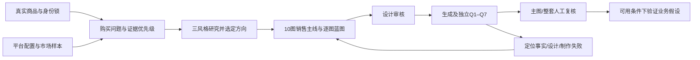

# 速卖通主图与套图视觉设计标准 V1.0 草案

日期：2026-10-22。状态：设计草案，待样本验证及审核，不是已冻结标准。

## 1. 当前目标与范围

建立以有效点击和购买决策为目标、可复用到Agent的视觉设计框架：明确为什么设计、怎样设计、怎样判失败。适用当前AliExpress单SKU的10张设计资产，首先验证商品903932105044、桔色SKU 5761489960647。

第01–03章锁定的事实门禁、身份锁、三风格研究、10图、独立QC、有限修复与版本记录继续有效。本文件细化视觉策略及Q6/Q7，不覆盖既有决定。本轮不编码、不生图、不上架，不引入独立生图API。

引用对话[补齐套图设计标准](https://chatgpt.com/c/6ada1e0d-fda0-83ee-bab2-b9db644cebc3)已通过所引用浏览器标签读取。采纳其中销售任务、视觉证据、构图蓝图、产品比例、文字层级、风格契约、Pass/Fail及整套防重复的要求。对话中的carrot与A+是其他任务背景，不迁入当前SKU和交付范围。

“高转化”是待验证目标。研究框架和设计评分不能证明本商品转化提升；当前没有该SKU的线上对照实验、已验证高转化竞品样本或已确认的店铺上传配置。

## 2. 三类规则必须分开

| 类型 | 来源与效力 | 使用方法 |
|---|---|---|
| 平台规则 | 适用当前站点、经营模式、类目、展示位置的官方要求或后台约束 | 必须记录来源、适用范围、核验日期；不满足不得正式放行 |
| 项目设计规则 | 本文提出的主图/套图商业验收方法 | 用于写任务书与拒收；不是官方政策 |
| 待测设计假设 | 主体占幅、留白、文字密度、构图方向和评分阈值等初始值 | 标为假设，先缩略图/人工验证，再看真实业务指标 |

### 2.1 已核实与未核实的速卖通规则

目前直接读取的[AliExpress区域官方图片说明](https://business.aliexpress-cis.com/help/article/images-requirements)面向seller.aliexpress.ru。该页区分首图、补充图、营销图和变体图，强调首图清楚呈现完整商品；列有浅色背景、商品占幅、文字限制及不同尺寸要求。页面还提供设计模板链接，具体位置之间须核清适用性，不能合并为一个通用参数。

**该区域说明不能当作当前中国跨境全球站店铺的已确认规则。** 本轮未取得当前店铺/类目的权威后台配置；官方Choice规则页检索到链接但未能读取正文。第三方教程出现的800px、1000px、5MB、6图等数值仅是线索，不采纳为已核实的全球站硬门槛。之前探针自定的1536px也不是平台规则。

因此：设计草案可以形成；当前`platform_profile`仍为UNVERIFIED，正式平台合规不得PASS。需要核实market、seller_mode、category、placement、aspect_ratios、minimum_dimensions、maximum_bytes、file_formats、text_policy、background_policy、gallery_limit、marketing_image_slot及来源/日期。

10张是本项目设计资产数，不等于平台主图区一定允许上传10张。未来按实际主图区、营销图、详情区容量映射；本轮不擅自减少10张交付或承诺10张全部上传主图区。

## 3. 成熟方法如何转化为本项目框架

以下是有出处的方法，经本项目适配；不是速卖通官方的“高转化公式”。

| 成熟依据 | 采用的部分 | 本项目落地 |
|---|---|---|
| [Conversion：LIFT Model](https://www.conversion.com/framework/the-lift-model/) | 价值主张、相关性、清晰度、顾虑、干扰，用来形成待测假设 | 每图解释“谁需要看、看懂什么、什么证据、消除什么顾虑”；促销紧迫性不默认加入商品图，禁止虚构折扣/库存/倒计时 |
| [NN/g：五项视觉设计原则](https://www.nngroup.com/articles/principles-visual-design/) | 大小、视觉层级、平衡、对比、格式塔 | 商品优先，文字和道具次之；统一网格及分组，利用与背景的差异突出商品 |
| [Baymard：不同商品图类型的决策作用](https://baymard.com/research-articles/secondary-hover-information) | 实物全貌、特征、使用场景各有用途 | 一张图只处理一个主要问题；换背景不算新增决策信息 |
| [Baymard：比例参照图](https://baymard.com/research-articles/in-scale-product-images) | 帮助消费者判断视觉大小和使用环境 | 用真实参照关系展示体量；没有测量证据不得标cm，不按未知大小道具推算尺寸 |
| [Baymard：图片内说明与移动端](https://baymard.com/research-articles/product-images-descriptive-text) | 说明图有价值，但缩小后文字可能失效 | 只保留解释证据所需文字，必须按实际显示尺寸检查；不把桌面可读当手机可读 |
| [Microsoft Research：实验指标解释风险](https://www.microsoft.com/en-us/research/publication/a-dirty-dozen-twelve-common-metric-interpretation-pitfalls-in-online-controlled-experiments/) | 指标变化需要结合实验设置解释 | CTR不能单独证明转化更好；控制变量、统一分母与归因，保留不确定结论 |

### 3.1 本项目设计决策链

销售主线：**识别商品 → 呈现购买理由 → 用可见证据解释 → 展示使用关系 → 解除误解与顾虑。** 消费者可以任意跳看，不要求按图序读完；每张都应能独立理解售卖对象。

## 4. 市场视觉研究规则

研究目的：发现品类的信息需求和有效视觉模式，不照抄竞争对手图、不用销量外观推断转化率。

初始采样目标（项目假设）：12个去重样本，以8个AliExpress、2个Amazon、1个Etsy、1个Pinterest为起点；不足时据实登记，不以低相关样本补数。这是研究起点，不是平台规定或统计代表性保证。当前本SKU此样本集未完成，不能声称已从竞品验证三个风格或选出胜者。

每个样本至少记录：来源URL/站点、采集日期、商品及价位可比性、可见图片、主图焦点/构图、商品与道具关系、文字密度、卖点证据、整套角色、可取模式、误导风险。商品原图必须实际查看；只有搜索摘要不能充当视觉样本。

销量、评价、排名如页面可见可以记录为当时的信号，同时注明影响因素未知；不能据此标“高转化”。Pinterest仅作视觉方向辅助，Amazon的图片政策不迁为AliExpress规则，竞品属性不迁为本品事实。

研究必须含正负对照。当前“黑包+大标题”人工拒收图作为已知负例；不能因为某款海报在其他站点出现，就判其适合本SKU首图。

提炼三种风格时，比较同一销售任务的色彩、光影、质感、景别和信息层级，而非给同一版式换三套颜色。按商品适合度、可实现保真、缩略图辨识、平台约束及证据支持选择一个方向，说明弃选理由。实际样本未到位时，只能输出暂定方向。

## 5. 首图设计规则：先看清卖什么

### 5.1 首图任务

首图主要承担搜索/列表识别与有效点击：买家首先识别当前SKU及其外观特点，对售卖对象和数量不产生误解。价格、物流、评价等由平台其他信息共同影响购买，本图不承诺独立解决全部转化因素。

三种候选构图的取舍：

| 构图 | 适用条件 | 主要风险 | 当前挂件判断 |
|---|---|---|---|
| 单品清晰展示 | 完整形态/颜色可直接体现商品特点 | 长绳占满画幅但花朵太小 | 优先形成首图方案，单独检查花朵识别，不能只看长绳外框 |
| 场景内突出单品 | 使用关系能帮助识别且道具不抢注意 | 把包误认成售卖主体 | 作为辅助图方向，首图采用需另有证据和平台许可 |
| 特征说明构图 | 有一个重要特征需要图文说明、该位置允许文字 | 大字替代商品、做成宣传海报 | 当前不作首图默认方案；可在支持的后续图位比较 |

### 5.2 主体、比例与构图

H01. 一个明确的售卖主体。当前桔色挂件整套的形态清楚，不能把黑包、大标题或装饰物做成第一视觉主体。

H02. 首图展示完整商品：花朵、绳尾、棕色单环、心形扣和棒棒糖的关键部分不裁掉、不拼成另一个结构。特写放后续图位，不能为放大笑脸而隐去正在售卖的连接件。

H03. 主体占幅必须看两层：完整商品的外框，以及真正用于识别的核心部位。长绳、细链等把外框拉得很大，不等于花朵/吊坠足够清楚。道具和阴影不计入商品外框。

H04. 初始构图探索值：完整商品最长方向约占画面75%–90%，边缘通常留5%–10%安全空间；均为项目设计假设，不是官方面积标准。根据商品形状、真实姿态、平台裁切及缩略图结果调整，不能同时把宽高强制拉伸到百分比。

H05. 长条类商品如核心部位太小，先换有实拍支持的摆放、朝向或原始角度。不能靠截短绳子、缩小五金、删除配件或制造不可能的姿态达标。缺少可用实拍时登记素材缺口；不能自动称“保真降级成功”。

H06. 背景服务于分离商品轮廓。当前SKU先探索白/浅中性色的干净背景，保留真实橙、绿、棕及金属色；这是内部候选方向，最终仍受适用平台配置约束。不得因“高级感”改变本品颜色、把布纹做成塑料或渲染成不同商品。

H07. 图中元素的注意优先级为商品、确有必要的说明、辅助场景。通过面积、位置、明暗、对比共同控制；不只用“大标题”建立层级。

### 5.3 首图文字和道具

H08. 当前SKU首图以无新增营销文字为初始方案。笑脸造型和配色由商品本身传达，不默认放“SMILEY FLOWER BAG CHARM”整块标题。以后需要文字时必须说明新增信息、平台许可及缩略图收益；不把空白填满当完成设计。

H09. 道具只用于已定义的使用或比例任务。当前首图不放完整黑包、杂志、桌面装饰；场景图可使用道具，但必须不造成包/额外商品随货附送的理解。实物包装内容未核实，不能写“1套含全部配件”“Gift Set”或明确清单。

H10. 不从商品文件名得出韩国产、手工、优质材料、防水等宣称；不加入没有证据的认证、排名、销量、折扣、时效或承重承诺。

### 5.4 缩略图检查

先按160px宽列表缩略图、320px宽详情预览做内部初检，再以目标平台实测展示宽度替换。二者是项目测试条件，不是平台上传分辨率。保持宽高比，不通过放大检查来替代缩略图检查。

内部3秒识别任务（筛查假设，不是转化实验）：观看者说出“卖什么、哪种外观/颜色、是否含道具”。当前挂件还要辨出花朵与笑脸；无需在160px看清每圈绳结，微观结构由原图放大质检。

FAIL条件：优先说出“包”；商品核心变为不可辨色块；必须读大段字才知道卖什么；首图出现不真实部件/错误SKU；裁掉关键配件；产生套数/附送物误解。只要明确命中其中一项，就不能靠总分或英文正确抵消。

不得声称已执行本SKU的160px/320px实测：本轮只制定检查方法，未生成缩略图或开展识别实验。

## 6. 套图信息架构：沿用10图，避免凑数

默认角色维持1首图、3卖点、2细节、3场景、1综合；主题、顺序依据问题和证据动态分配。不把十张做成十幅外观海报。

| 默认角色 | 首要购买问题 | 必须带来的信息 | 典型失败 |
|---|---|---|---|
| 首图×1 | 这是什么，外观是否吸引我？ | 当前SKU清晰全貌及可辨特点 | 主体小、道具抢戏、海报化 |
| 卖点×3 | 我为什么选它？ | 三个各有证据、不同的购买理由 | 同一事实换三种说法，或文字先于证据 |
| 细节×2 | 实际做工/结构是什么样？ | 近距可核对的纹理、连接等 | 编造精密纹理、模糊遮盖关键部位 |
| 场景×3 | 如何使用、怎样搭配、体量怎样？ | 三项独立的使用/搭配/比例信息 | 换背景却没有新信息，或伪造适配/比例 |
| 综合×1 | 决定购买前还有什么关键疑问？ | 有证据的选购澄清或关键结构总览 | 机械重复首图，虚构包装/尺寸补满 |

图序策略：首图固定第一；前几张优先回答最有影响且最有证据的问题，不要求所有卖点必须排在所有场景前。尺寸是核心顾虑且有真实测量时可提前；没有证据时换成其他有效主题，不画假尺寸。

逐图登记“主问题—唯一主要答案—证据—与其他图的差异”。如果无法说明差异，就回到图计划调整；不能靠添加句子凑出独特性。若现有素材不足以支撑默认分配，提出有依据的主题/排序调整供设计审核，不能自行改已锁定数量或生产重复图。

## 7. 统一风格契约

三风格比较后，每套锁定一份Style Contract，至少含背景色及使用范围、真实商品色基准、光线方向/软硬、接触阴影、景别、摄影质感、字体家族、标题/辅助层级、对齐网格、边距、图形标注和语言。

全套统一的是规则，不是所有图套一个模板。全貌、特写和场景采用不同构图以体现各自任务；不允许同一商品跨图变花瓣、改绿色结、变扣形。

文字图以一个短标题及必要的证据说明为初始限制；标题约3–6个英文词、辅助说明约0–12个词，都是可调整的内部探索值。不能为凑词数删掉必要限定，不允许通过堆小字免责。最多两级主要文字层级，信息确有需要时说明增加层级理由；无字图明确N/A。

AI继续负责完整营销图的英文与排版，不改为默认程序叠字。照片背景既有文字不得成为新增商品宣称；应优先选干净素材或无误导的处理方式，不以“它原来就有”豁免主图杂乱。

## 8. 每张图先有蓝图，再有Prompt

| 必填字段 | 要回答的问题 |
|---|---|
| image_id / role / placement | 哪一张、承担什么角色、拟用于哪里？ |
| sales_task / customer_question | 只优先回答哪个购买问题？ |
| conversion_hypothesis | 预期通过什么机制改善哪个指标？目前证据是什么？ |
| visual_proof / source_refs | 哪张原图、哪项事实能证明？哪些仍未知？ |
| composition_blueprint | 主体/核心部位/文字/道具分别在哪里？视线顺序是什么？ |
| product_scale / crop_safe_area | 完整外框、核心辨识、留边如何检查？如何避免裁错？ |
| text_hierarchy / exact_copy | 是否有字？准确英文及事实依据是什么？ |
| style_contract_ref | 遵循哪个已选风格与版本？ |
| identity_constraints / forbidden_changes | 哪些商品结构绝对不能改？ |
| production_method | 真实合成或受控生成如何保持身份？方法能力是否已验证？ |
| pass_fail / preview_conditions | 哪些结果立即FAIL？缩略图和全尺寸分别看什么？ |
| unique_information / prior_image_difference | 为什么需要本图，和前图有什么不同？ |
| platform_profile_ref / approval_state | 平台适用性如何，是否已通过设计审核？ |

缺任一关键字段时，先完成设计，不进入生成。平台配置未核实可继续出草案，但不能把设计样张标为合规成品。

独立QC必须取得图位任务书、平台配置、身份锁、原图及候选图。隔离的是生成过程和自评历史，不是把图位任务和设计标准也隔离掉。生成器说“适合主图”不算证据。

## 9. QC：硬门槛优先，设计分仅辅助排序

### 9.1 在Q1–Q7内细化，不另造一套放行口径

| 原门禁 | 本标准补充检查 | 不能自动PASS的情况 |
|---|---|---|
| Q1文件 | 解码、尺寸、体积、比例、真实输出；绑定适用平台配置 | profile未知时平台合规为UNKNOWN |
| Q2 SKU | 当前选择与输出一致，数量/颜色不混入其他SKU | 竞品/相似款代替本SKU |
| Q3身份 | 核对结构、比例、纹理、颜色、连接及绳尾，不臆造隐藏部位 | 视觉相似却改实物结构 |
| Q4事实 | 每项文案、图标、示意关系均有证据 | 缺证但写成确定功能/尺寸 |
| Q5英文 | exact_copy逐字比对、语义准确、无截字 | 类目名正确但新增了无依据卖点 |
| Q6设计与可读性 | 先查图位销售任务、主体优先级，再查构图、缩略图与文字 | 产品保真却不适合首图；未检查不能PASS |
| Q7整套 | 风格/身份一致、问题覆盖、信息去重、图序和上传位置映射 | 十张都像同一张，或核心疑问缺失 |

角色错配、商品失真、错误事实、误导包含物及关键文字错误均属于拒收条件，不用设计分抵消。未知写UNKNOWN/REVIEW，失败写FAIL，不能以平均分掩盖。

### 9.2 设计评分初版（项目假设，尚未校准）

硬门槛全部通过后，按0–5分评价：主体与售卖对象25%、信息层级20%、证据表达20%、移动端辨识20%、风格完成度15%。总分=各维度得分/5×权重之和。0=不可用，1=严重不足，2=明显欠缺，3=基本满足，4=清楚有效，5=该任务表达出色；每项必须有观察依据。

内部初始候选线85/100；首图主体及移动端维度各至少4/5，其余至少3/5。任一项未检查，总分不计算，进入REVIEW。阈值是待人工样本校准的起点，不是行业标准、CTR/CVR预测器或上线许可。

整套另做二元审核：10个任务可解释、关键购买问题覆盖、主要答案不机械重复、商品/风格一致、每图独立可理解、位置映射可行。任何关键项FAIL，整套不合格，即使单图均高分。

### 9.3 当前拒收图的回归用例

`01_fallback_ai_qc_pass.png`已有人工主图FAIL，必须保持拒收。既有身份/英文局部AI PASS可以保留为分项历史。按本标准，主图用途和主体优先级不通过；160px识别测试未运行，不伪造结果；不计算整体设计分。

未来校准至少覆盖：保真但海报化、道具抢主体、长绳占框而核心过小、漂亮但结构错、英文正确但宣称无证、微字移动端失效、十图重复、平台配置未知，以及正常样本。仍遵守10正常+10错误、人工标注对照要求；本轮只是制定用例，不代表校准已执行。

## 10. 当前挂件首图任务书初版

这是框架应用草案，不是已经选定的市场风格，也没有生成新图。

- 销售任务：一眼识别桔色笑脸花朵挂件整套，突出真实造型和配色，不让人以为卖包。
- 可见依据：主图_01.jpg、主图_02.jpg、描述图_03.jpg；原照片为身份依据，文件名/SEO/竞品不是属性证据。
- 第一视觉：六片桔色布艺花瓣与黄色笑脸；随后识别心形扣、绳与棒棒糖为同件结构。完整结构不能为花朵放大而牺牲。
- 构图：单件集中展示，干净浅底和自然接触阴影；使用有证据的真实姿态。最长方向先探索75%–90%，核心是否清楚另验，不承诺固定花朵面积。
- 文字：初版无新增营销文案；不放大标题，不放黑包/杂志/装饰物。此为本SKU内部设计方向，非全平台禁字结论。
- 制作：主图优先真实产品合成。调用原生生图不等于证明原产品像素已被保留；具体方法及保真能力仍需验证，不能为完成画面重造绳结或扣件。
- 禁止：双棕环、多层绿色大绕结、心形扣变封闭装饰环、重构绳尾、虚构数量/尺寸/成分/产地/耐用性。
- 缺口：当前完整包装清单、测量尺寸与具体材质未知；主图不靠文字推断这些事实。黑包作为道具不假定随货；完整挂件的实际随货范围仍须确认后才能明确承诺。
- PASS：图位任务成立、身份/事实正确、缩略图辨识通过、平台配置满足、设计审核通过；首轮继续人工复核。
- FAIL：看成卖包、核心不可辨、必须读大字才明白商品、漏/改配件、套数误解、关键部位裁切；现有拒收图不能换标签转为合格首图。

对应结构化示例见同目录`2026-10-22-ae-main-image-brief-example.json`。

## 11. “高转化”如何验证

先验证设计可理解，再验证业务效果。不能用AI打分、自己喜欢或竞品评价数代替转化率。

主图试验先固定一个差异，如主体大小或背景复杂度；不同时改标题、价格、SKU、物流承诺和投放。只有在平台支持、用户授权且能正确分流时才运行线上对照；本轮不启动任何发布或投放。

指标口径必须来自同一人群/时间窗口/归因定义：曝光E、有效点击C、点击归因订单O。CTR=C/E，点击后订单率=O/C，每千次曝光订单=1000×O/E；只有分母及归因一致时，后者才等于1000×CTR×点击后订单率。不能把按访客算的店铺CVR直接乘以按点击算的CTR。

目标是在不增加误导的前提下改善每千次曝光订单等业务结果；CTR与点击后转化作为解释指标，退货/投诉及售卖对象误解作为护栏。CTR上升而购买质量下降，不自动胜出。

事先登记假设、唯一主指标、最小有意义变化、样本/时长依据、随机化单位与停止规则；检查分流/数据异常，不看到一次上升就停。无法随机分流时可做受控观察，但要标为相关性证据，不能声称因果提升。当前没有基线数据，不编造通用“测试7天/100点击即可”门槛。

## 12. 错误归因与修复去向

| 问题 | 回到哪里 | 禁止的处理 |
|---|---|---|
| 平台适用范围不明 | platform_profile核验 | 把别站/区域规则填入PASS |
| 声称没有证据 | 事实/选题 | 让生图模型补一个看似合理的答案 |
| 主图像海报、主体错位 | Sales Task与Composition Blueprint | 原Prompt无变化地重复生图 |
| 身份局部失真 | 原照片、制作方法和针对性修复 | 为图好看修改身份锁 |
| 十图重复 | 套图问题覆盖与排序 | 再换十种背景 |

原RUN两次针对性修复+一次降级上限保持耗尽，不暗中重置。新设计先审核蓝图和新增假设；之后若获准验证，建立可追溯的新版本，仍受有限预算约束。

## 13. 本轮验收与下一步

本轮交付：有来源与适用范围的规则草案、成熟方法映射、首图规则、10图信息架构、逐图字段、Q1–Q7细化及评分假设、当前SKU首图蓝图和业务验证方法。

验证范围：来源已实际阅读；检查结构化首图示例字段、权重、硬门槛及人工拒收状态一致性。未生图、未开展新视觉QC/缩略图用户测试、未做线上实验，不声称高转化已达成。

下一步按顺序：完成当前店铺platform_profile及品类视觉样本 → 三风格研究与选择 → 当前SKU完整10图Storyboard（不生图）→ 审核任务/证据/构图/重复 → 再安排有限新版本图像验证和QC校准。第04章最终审核与技术实施仍独立待完成。

Backlog：其他类目复用、批量、多用户、自动上架和长期经营实验；不借本轮扩大开发范围。
