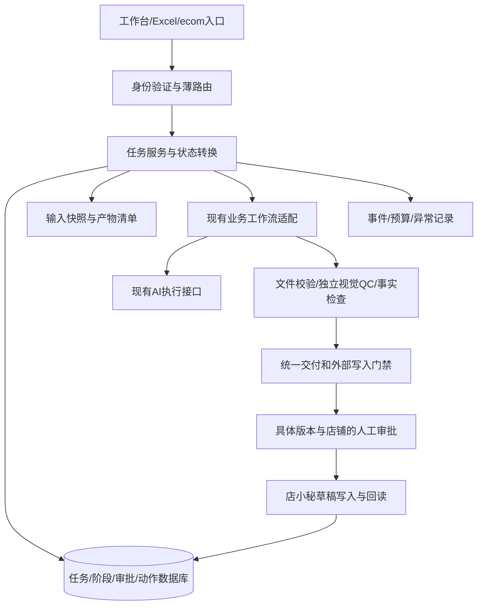

# 一跨而境可靠性升级详细方案

日期：2026-10-24。版本：v1。状态：用户已授权分阶段实施；首批核心修复进度见[阶段报告](../reports/2026-10-24-reliability-phase1.md)。后续工作包及真实业务验收尚未完成。

## 1. 目标、范围和设计选择

目标：保留现有工作台和已锁定业务规则，把当前约6.5分的系统逐步升级为可在明确商品范围内稳定交付、可监督、可恢复的内部生产工具。9.5分是升级后的复评目标，不是完成开发即可兑现的承诺。

本方案假设：单机/局域网内部团队，AliExpress Choice为首个验收场景；生成和本地检查可自动运行，店小秘写入按明确授权范围执行；默认交付经过回读的草稿，正式发布保留人工决策。本次不新增自动正式发布能力，也不自动停用已有业务入口。

三个可选方向：

| 方向 | 优点 | 代价和适用范围 |
|---|---|---|
| 仅修当前缺陷 | 最短路径解决具体误放行和状态覆盖 | 多套任务/审批逻辑继续分化，难以稳定达到高分 |
| **渐进加固，共用可靠性模块（推荐）** | 复用现有UI、适配器、SQLite、manifest和ecom契约，逐入口迁移 | 需要明确唯一状态来源及兼容边界 |
| 全量重建后端/微服务/多Agent平台 | 可重新整理所有模块 | 迁移与回归范围过大，当前没有相应收益证据 |

设计选择：采用第二种。保持Node/Express和现有文件部署方式；数据库沿用项目已使用的SQLite能力，先覆盖新迁入的任务、审批和外部动作，不一次迁移全部运营JSON。AI负责识别、调研、规划、生成和独立视觉检查；代码负责状态转换、权限、事实和文件检查、重试上限、交付与写入门禁。

## 2. 约束与最新代码事实

### 必须保留

- 现有Node/Express主工作台和界面，保留用户已有改动、业务文件和历史商品。
- 当前部署以dist/src下ESM JS为实际实现；本轮不强制恢复TypeScript源码树，不引入新的打包迁移。
- 当前上品各阶段统一使用配置的模型和推理档位，不按阶段偷偷切换快模型。以dist/src/config.js为配置事实，执行时记录实际生效配置。
- 新十图原生方案继续遵守原路线图门禁；旧网页8图Agent不能代替它通过验收。不新增按次生图服务作为默认依赖。
- 类目、图片数量、尺寸和用途按已批准的工作流版本保存。通用运行层不把10图硬编码到翻译原图、挂件六图、内胆等其他场景。
- 不臆造重量、包装尺寸、材质、库存、价格及其他商品事实。未知、冲突、推断分别记录。
- 未获授权的外部写入、账号切换、正式发布及删除不因本方案获得授权。

### 本次重新核对

| 模块 | 已有基础 | 本方案补强点 |
|---|---|---|
| listing-agent | Parse/Generate/Validate/Publish分层，可注入AI和publisher | 硬错误不能退化为可发布警告；统一写入门禁 |
| agents/ae-product-design | 模块化规划、生成、QC、逐槽位恢复和预算 | 首图评分接入判定；兜底不得虚报覆盖；旧缓存验证 |
| progress-manifest.js | step产物路径、sha256、大小、校验复用 | productKey目前取objectiveInfo和图名；升级为输入内容和规则版本指纹，原子保存 |
| image-framework.js | 十图槽位、第3槽尺寸/比例、场景数量检查 | 保留已批准规则，增加结构化ImagePlan，文本解析作为兼容入口 |
| charm-listing-workspace-service | SQLite、草稿版本、审批、幂等键、回执 | 复用模式，补事务和审批范围；不直接重写其类目业务 |
| ecom-contract/ecom-connector | 事实来源、reviewRequired、冲突落incoming、导入幂等 | Schema适配、单位、完整产物签名、事务化导入和来源门禁 |
| dianxiaomi-adapter.save | 已排除发布等按钮，已有toast/页面字段回读 | 草稿列表级存在性与身份回读；结果未知不得自动再建 |
| secretary-model | 意图草稿编译、代码风险下限、异常降级 | 经统一授权和门禁执行；模型结果不能直接改变审批和权限 |

上一轮137项测试112通过25失败属于2026-10-23的验证结果，本日代码已变化，不能称为今天的通过率。本次只重新阅读相关文件，未重跑业务测试、浏览器或外部系统。

## 3. 目标架构与唯一状态来源

控制流仍以预定义流程为主，只允许在受限范围内修复。正常终止条件为达到该工作流的交付目标；异常终止为预算耗尽、证据缺失、身份不匹配、人工暂停、取消或不可恢复错误。

### 状态来源规则

1. 尚未迁移的旧入口：原存储仍为事实来源；只接入公共门禁与资源调度，不伪装成新任务库已接管。
2. 已迁移任务：任务数据库是阶段、审批、外部动作的唯一事实来源；JSON、现有run-state、旧面板只作为兼容投影。投影失败显示告警，可重建，不反向覆盖数据库。
3. 图片和文案文件是产物内容；数据库/manifest记录其版本、哈希和相对路径。文件存在本身不代表已验收。
4. 一个任务创建时固定engineVersion和storageOwner；运行中不能切换新旧引擎。同一商品、同一浏览器资源不允许两个引擎同时写入。
5. 先迁移一个场景，再逐入口扩展；不实行长期双向双写。

## 4. P0：优先修复已确认的硬门禁

### 4.1 发布校验

修改listing-agent/src/listing-agent.js和stages/validate-stage.js：

- 把Schema硬错误、业务缺项、来源复核要求转成统一blockers；Schema硬错误不能仅因missing=[]而返回可执行成功。
- 生成结果可保留为草稿；能否提交由canSaveDraft/canPublish等动作级权限决定，不由success_with_warnings字符串推断。
- 纯additionalProperties差异先通过明确的Schema版本/适配层解决；未知字段可保留为元数据，但不能忽略类型错或把整套校验放宽。
- 设置修复次数的有效整数范围；0表示不修复，禁止无上限或非法轮数。
- 所有入口，包括旧引用、采集箱、批处理、独立Agent、挂件和秘书触发的写动作，都在实际调用适配器前执行同一动作门禁。

拒绝时返回结构化原因：code、字段/证据位置、是否可自动修复、允许的后续动作。人工审批不能覆盖Schema错误、错店铺、缺关键事实及文件哈希错误。

验收：非法weight类型、缺主图、来源要求复核、过期审批、错误店铺等场景，外部写入调用次数全部为0；警告只有在明确属于非阻断类别时才可继续。

### 4.2 QC判定

修改旧视觉qc.js/runner.js，并把聚合判定提取为可复用纯函数：

- QC每个检查项只有PASS/FAIL/UNVERIFIED/NOT_APPLICABLE四种结果，包含方法、证据、规则版本和时间。
- NOT_APPLICABLE必须由已冻结的槽位规则决定，不能在检查失败后临时改为不适用。
- 必查项全部PASS、所有需要的事实有证据，才能总体PASS。首图还必须满足该版本heroJudge的分项与总分门槛。
- 云端QC失败、本地兜底只覆盖3项时，只能回填这3项；尺寸继续由文件校验获得，其他项保留UNVERIFIED。
- 出图成功、下载成功、保存成功分别记录，均不能等价于QC通过。
- 通过项、失败项和候选项分开保存，只有经过门禁的版本才能进入最终交付清单。

验收：0分首图不能通过；SKU对但结构错不能通过；QC不可用不能通过；已有合格图不会被修复流程删除或覆盖。

### 4.3 主状态文件保护

先修dist/src/state-store.js，暂不等待任务库迁移：同文件串行队列、同目录临时文件、替换与最后有效快照；保存快照也必须校验后再更新。只有ENOENT按初次启动处理；JSON损坏、权限错误分别报告，保留原文件，允许从有效快照恢复。不得静默把损坏文件覆盖为IDLE。

验收：写入中止、损坏JSON、磁盘不可写、并发更新均有隔离测试。进程被终止后最多丢失尚未确认完成的那一步，不虚报整个任务成功。原子文件写不宣称覆盖所有断电/硬件故障，后续数据库和备份共同提供恢复能力。

## 5. P1：统一任务、输入与恢复

### 5.1 任务数据模型（设计字段，不是已实现接口）

| 对象 | 关键字段和约束 |
|---|---|
| Job | jobId、productId、instanceId、operatorId、workflowType/version、engineVersion、storageOwner、targetStoreId、goal、status、revision、inputFingerprint |
| StepAttempt | jobId、stepId、attemptNo、status、inputFingerprint、startedAt/endedAt、errorCode、outputManifestHash |
| Artifact | artifactId、jobId、stepId、relativePath、sha256、bytes、kind、sourceArtifactIds、qcRevision、deliveryStatus |
| Approval | approvalId、jobId、draftVersion、draftHash、storeId、action、approvedBy、approvedAt、expiresAt、status、operationKey |
| ExternalAction | actionId、operationKey UNIQUE、jobId、actionType、storeId、payloadHash、status、externalId、evidenceRef |
| Event | eventId、jobId、stepId、attemptNo、type、time、actorId、safeSummary |
| ResourceLease | resourceKey UNIQUE、ownerJobId、leaseToken、leaseVersion、heartbeatAt、expiresAt、releaseStatus |

新共用任务数据建议放USER_DATA_DIR/data/workbench-runtime.sqlite。已有挂件数据库保持原位，按明确适配接入；不复制其业务表为第二套商品主库。Job.productId引用已有商品身份，不能以可变商品标题充当唯一ID。

步骤、产物和外部动作的键分别隔离；重试创建新StepAttempt，不覆盖上次证据。数据库状态、审批消费和外部动作预登记必须在同一事务内完成。同步数据库事务保持短小，图像处理和文件哈希不在长事务中执行。

### 5.2 RunManifest与输入冻结

每次运行保存到该实例data/runs/<jobId>/<runId>/，至少包含input-manifest.json、步骤产物清单、QC、event摘要及外部回读证据。大型输入可引用按内容哈希保存的只读副本，不能引用会随当前商品切换而变化的路径。

inputFingerprint使用规范化JSON和文件内容SHA-256组成，覆盖：原始参考图、商品事实、来源标记、SKU映射、Prompt哈希、工作流/规则/平台配置版本、图槽位配置和执行模型配置。数据库生成时间和日志时间不进入内容指纹。

扩展现有progress-manifest，而不另写一套只看文件名的进度系统。v1旧manifest只能用于查阅；v2验证缺少输入指纹时要求重新确认，不能无条件继承通过态。相对路径需校验仍位于该run目录，防止引用外部文件。

阶段失效规则：

| 输入变化 | 最小失效范围 |
|---|---|
| 参考图或商品事实变化 | 依赖变化项的识别、规划、图片、文案、QC和全部写入审批 |
| 仅图片文件被修改/删除 | 对应产物及其QC、引用它的交付草稿和审批 |
| 仅店铺/模板变化 | 店小秘字段计划、审批和写入回读；纯视觉结果可保留 |
| 仅Prompt或QC规则变化 | 受对应版本影响的阶段；保留历史，不回写旧报告 |
| 仅日志/显示名称变化 | 不失效业务产物 |

### 5.3 状态机

统一任务状态建议为CREATED、NEEDS_INPUT、QUEUED、RUNNING、WAITING_QC、REVIEW_REQUIRED、APPROVED、SAVING_DRAFT、RECONCILING、DRAFT_VERIFIED、COMPLETED、PAUSED、BLOCKED、FAILED、CANCELED。

- COMPLETED表示满足Job.goal。draft_only目标可在草稿证据通过后完成；assets_only目标在合格资产交付后完成。两者均不表示线上已发布。
- 外部动作独立使用PREPARED、EXECUTING、VERIFIED、UNKNOWN、FAILED。UNKNOWN进入RECONCILING，禁止新建第二个动作。
- 允许转换由代码表控制，使用revision防止两个请求同时推进。非法转换返回冲突，不修改状态。
- 用户取消时若保存已发出，先停止新步骤，再核对已发生副作用；不能通过改成CANCELED掩盖已经保存的草稿。
- 接口返回202和jobId，旧面板可继续读取兼容视图。状态查询不再以501代替任务可观察性。

### 5.4 浏览器与跨进程互斥

先按真实共享资源串行：Chrome调试端口+浏览器profile为一个资源；同一页面/共享当前产品目录也单独加锁。旧入口与新入口必须竞争同一把锁，不只检查各自的running布尔值。

租约持久化并带owner和递增版本。租约过期不代表可以直接抢占：先确认原进程已停止、浏览器自动化已中止或进入人工核对；旧worker恢复后所有写动作必须重新验证租约。暂停/失联时不得让旧worker和新worker同时操作网页。模型/浏览器接口不能提供严格fencing时，默认整个profile单worker，人工确认后才重新分配。

可并行本地文件检查及独立导入；不并行操控同一登录会话。增加吞吐前先测量资源占用，初版不靠开更多Agent提速。

## 6. P1：事实、ecom和交付契约

### 6.1 事实与经营配置分离

商品事实保存值、单位、来源文件/图片、证据位置、核验状态；经营配置保存目标店铺、模板、履约、人工定价和库存。AI输出营销表述不能写成尺寸、重量或合规事实。

重量统一存数值kg，原始值和单位留在provenance；店小秘页面需要g时仅在适配器边界转换。该单位约定为本方案建议，实施前按现有Schema与类目逐项回归。裸字符串、未知单位、商品重量与包装重量混淆均进入blockers，不填默认100g或猜测包装尺寸。

ecom导入先区分“导入成功”和“事实可执行”：reviewRequired、gaps、conflicts须保留。仅分析或文案草稿可继续，外部草稿写入需要动作相关关键事实已核验。事实Schema与适配元数据Schema分开，ecom当前keyAttributes等结构差异用明确映射测试解决。

### 6.2 导入完整性

完整产物manifest是幂等判断依据，不能只比较product-facts.json。覆盖原始图、翻译图、SEO、Listing、来源文档、人工覆盖和契约版本。产品身份包含来源命名空间与相对目录，避免不同类目同名商品碰撞。

导入流程：允许目录检查→解析与Schema验证→staging完整拷贝→校验全部清单→切换为可见目标→提交台账。任务库记录PREPARED/COMMITTED及目标manifest；启动时修复“文件已就位但台账未提交”或相反的中间态。文件系统与SQLite之间不假设有跨系统原子事务。

已有目标与新包冲突时保持incoming待人工裁决；不覆盖手工改动。仅修改同名图片内容或文案时必须被识别为变化，不能误判SKIPPED。缺失必需产物不能静默continue后宣称完整导入。

### 6.3 资料出站边界

外发仅取显式允许的商品资料，不扫描目录任意md/txt。对结构化事实、自由文本、图片旁注等全部输入统一执行允许清单和脱敏；成本、采购价、供应商和账号信息不进入营销生成上下文。研究网页/导入文档作为数据，不得取得任务权限或覆盖店铺、审批和预算。

## 7. P1：店小秘草稿执行与核对

### 7.1 计划和执行分开

在现有adapter之前生成FieldPlan：planVersion、jobId、storeId、templateId、sourceDraftVersion、inputFingerprint、fields、blockers、attention。每个字段包含value、unit、sourceRefs、action及回读方法。动作限FILL、PRESERVE_OR_VERIFY、MISSING_SOURCE。

现有填表能力保留；执行器只执行通过门禁的计划，不临时猜值。店铺、类目、模板、SKU行映射、包装数据在写前和写后核对，SKU数量或身份不一致即停止。浏览器页面结构变化须显式报错，不以模糊点击自动选最相近项。

### 7.2 动作范围与审批

区分GENERATE_LOCAL、SAVE_DRAFT、UPDATE_DRAFT、PUBLISH_LIVE、DELETE。初版共用执行器仅实现前3种；PUBLISH_LIVE不进入自动执行器。原有人工正式发布入口若保留，仍需单独明确授权，不由本次草稿审批解锁。

审批绑定jobId、draftHash/version、storeId、action、inputFingerprint；建议有效期24小时，作为产品默认值可在实施规格中调整。消费时再次检查全部硬门禁，在同一事务将审批绑定到唯一operationKey。相同操作重试只能查询/恢复该operation，不再次消耗审批或产生另一份草稿；任何内容或店铺变化均使原审批失效。

业务上若需要一次审批一个批次，批次必须列出固定商品、店铺、版本哈希和动作；新增行不自动加入授权范围。硬错误或未知事实不允许批次审批豁免。

### 7.3 回读与防重复

点击保存前持久化PREPARED记录及幂等键：jobId+storeId+action+draftHash。点击后转EXECUTING。只有列表/编辑详情可确认的草稿ID、目标店铺、关键字段、SKU和图文证据符合FieldPlan，才VERIFIED。

标题只作为候选搜索条件，不能作为唯一身份证明；同标题多条且无法区分时UNKNOWN。没有错误提示、页面URL变化或出现toast都不足以单独证明草稿存在且属于本商品。

断网/超时/进程退出：先按已知draftId/editUrl和操作证据核对；可确认存在则补记成功；可确认失败才允许按同一计划重试；无法确认保持UNKNOWN并请求人工核对，禁止自动再建。对不支持服务端幂等键的网站，不声称能技术上保证exactly-once，以“预登记+保守核对+不明不重建”降低重复风险。

最终回执包含draftId、storeId、editUrl、input/plan/draft哈希、关键字段对比、verifiedAt、截图/页面证据引用；身份和hash由执行器生成/校验。人工上传的externalId仅为待核对线索，不能直接把状态改为LIVE或VERIFIED。

## 8. P1：身份、授权与可审计操作

复用operators档案中的身份ID，但角色档案不等于登录认证。增加本地登录凭据和服务端会话；默认无通用密码，首个管理员通过本机一次性初始化建立，密码只存带独立盐的密码哈希。远程初始化不开放，登录接口限速，会话可注销/撤销。

角色初版为viewer、operator、approver、admin：viewer只读；operator制作与补资料；approver审批有范围的草稿动作；admin管理账号/配置。小团队允许同一人兼角色，但仍记录真实操作者；可选双人复核不作为首版硬依赖。

统一中间件先于所有业务路由。健康检查只回进程信息；业务状态、产物、图片、审批、事件和配置均受认证/范围控制。Cookie会话使用HttpOnly和SameSite，写接口校验CSRF及来源；局域网团队部署配置HTTPS后才启用远程登录。上线前不直接关闭现有局域网入口，按新旧访问兼容演练并完成迁移；本地测试实例可绑定127.0.0.1。

审批接口不接受客户端指定approvedBy充当身份；日志不记录会话令牌、完整凭据和敏感Prompt。仅有角色还不足：每次访问校验instanceId、jobId、storeId与允许范围。首版不做对外多租户计费和组织管理。

## 9. P2：业务质量、评测与运行成本

### 9.1 质量验收

冻结独立验收样本，建议30个有代表性的真实SKU，每个受支持类目至少5个；不够覆盖的类目标为未认证。样本覆盖颜色、金属/毛绒/透明等材质、相似SKU、多配件、缺规格、冲突来源、品牌/IP风险、无尺寸证据以及容易生成失真的结构。验收集与开发调试样本分开，避免反复按同一批样本调Prompt后仍称独立验收。

另建至少100项确定性/替身故障与边界用例，覆盖硬门禁、状态转换、回读未知、防重复、隔离和权限。这100项不是100个独立真实任务，也不拿它冒充真实成功率。

视觉标准由人工审核通过/拒收样例组成：参考图保真、槽位目的、画面重复、尺寸/数量事实、英文准确、缩略图可读性和整套一致性。AI每项二元结论附证据；人工重点复核已知缺陷和通过样本。建议每个高风险判定累积至少50个人工确认正例和50个反例，再报告漏放/误拒；样本不足只报告当前观察和待补证据。

建议目标（全部是验收提案，非当前成绩）：

- 预定义硬门禁反例全部拦住，错店铺、串商品、未经授权写入、未知结果自动重建为0起。
- 独立真实SKU首轮合格任务比例目标≥90%；在固定修复预算内最终合格比例目标≥95%。目标分母为所有已发起的合格输入任务，失败、超预算和依赖不可用单列且计入总账，不能通过排除失败抬高总成功率。
- 首轮/最终合格均由人工按固定rubric判定，不按“文件数已齐”统计；生成成功率、合格图片率、整套合格率分别报告。
- 连续试运行至少14个工作日且累计≥100个真实任务后复评；每个目标类目保持足够样本，报告样本数与置信区间，不能把有限样本无事故当成永久安全。

图像平台规格采用可版本化PlatformProfile，来源和核验时间可追溯；本方案不新增未经核实的尺寸或宣传平台合规。

### 9.2 程序验证

测试分4层：纯函数/Schema与状态单测；持久化/租约/并发/导入集成；浏览器假页面的字段与选择器契约；专用商品和店铺草稿的真实端到端。外部测试按具体授权运行，默认检查不联网、不生图、不写店小秘。

修复路径漂移和缺失夹具，保留每项失败的真实原因；平台差异分组标注，跳过项必须列明且不计入通过。加入Windows基线与项目声明支持的运行环境检查，源码检查使用真实dist路径。根测试命令应覆盖现有dist/test、listing-agent/test以及新增可靠性测试；旧视觉无评测执行器时补充实际可运行的判定测试，而不是只放cases.json。

### 9.3 追踪、预算和界面

每任务记录job/run/step/attempt、输入和规则版本、配置及实际模型、耗时、修复次数、QC、人工介入、外部回执和错误码。日志默认摘要和哈希，保留策略与删除范围明确；截图敏感信息脱敏。

预算在任务创建时冻结并跨重启累计，区分每图修复、整任务调用、运行时长与人工介入。新十图方案先沿用既定最多2次针对性修复及必要时1次安全降级的候选上限，正式实施前与已锁定规格统一；安全降级不允许降低QC放行条件。免费/订阅额度拿不到精确费用时记录次数、耗时及费用未知，不虚填0元。已有次数上限保留，优化优先减少重复调用、无效轮询及无变化重跑，不降模型档位。

界面改动限定在任务详情、审批、异常和运行概览：当前阶段、已验收进度、阻断原因、下一步、恢复动作、商品/店铺、输入版本、合格/拒收产物和外部草稿证据。不得用文件数充当合格进度，不把DRAFT_VERIFIED显示成“已上架”。正常用户不需要看到模型协议、数据库字段和哈希细节。

## 10. 模块落点与接口草案

以下名称是本方案建议，不表示文件已存在或接口已交付。实施计划在方案定稿后固定签名。

| 新增/扩展 | 职责 | 输入→输出 |
|---|---|---|
| dist/src/reliability/gates.js（新） | 聚合交付/动作门禁 | evaluateGate({action,job,facts,qc,artifacts,approval,actor}) → {allowed,blockers,warnings} |
| dist/src/reliability/json-store.js（新） | JSON串行写、快照、损坏恢复 | readCheckedJson / writeCheckedJson，不静默吞错误 |
| dist/src/reliability/runtime-store.js（新） | 数据迁移、事务、revision、审批、事件、租约、动作唯一键 | 数据库接口；无浏览器/AI调用 |
| dist/src/reliability/jobs.js（新） | 创建、推进、暂停、恢复、取消、预算 | 固定Job上下文及状态转换；调用runtime-store |
| dist/src/reliability/access.js（新） | 登录会话、权限、CSRF、范围 | 服务端actor与requirePermission(action,scope) |
| dist/src/reliability/external-actions.js（新） | 预登记、幂等、未知核对 | prepare / execute / reconcile，持有operationKey |
| progress-manifest.js（扩展） | 输入及产物版本、哈希、路径范围 | v2manifest；旧v1只读兼容 |
| dianxiaomi-adapter.js（扩展） | 现有填表、精确草稿动作、可核对回执 | FieldPlan → 执行证据；不自行定义授权 |
| ecom-contract/ecom-connector（扩展） | 事实映射、完整包签名、staging导入 | 外部包→规范事实+产物+待复核原因 |
| server.js/批处理/Agent/挂件/秘书（接入） | 薄路由与既有场景适配 | actor+Job上下文→共用门禁/任务服务 |
| public/app.js等（局部扩展） | 状态、审批、异常、证据展示 | 业务视图；不扩大导航重构 |

新增6个共用实现模块是责任边界建议，不要求先搭空框架；随各工作包实际需要引入。优先复用现有函数，避免把每个检查拆成新服务。

## 11. 工作包、依赖和交付

每包都按“先写行为失败用例→最小修改→验证→独立审查→记录证据”执行；本方案不自动授权提交现有全部未提交文件。

| 工作包 | 主要修改/新增 | 可独立验收交付 | 依赖 |
|---|---|---|---|
| W0 基线 | 工作流/写接口清单、隔离验证脚本、测试基线记录 | 识别现有改动、数据备份清单、每个外部动作归属；不移动真实商品 | 无 |
| W1 硬门禁 | listing-agent、gates、旧QC、对应行为测试 | 6类已知误放行反例全部阻断；新十图后端门禁保持 | W0 |
| W2 JSON保护 | state-store、json-store、manifest保存、ecom台账 | 损坏/不可写/并发保护；无静默重置 | W0 |
| W3 身份边界 | access、server、审批身份及私有资源路由、最小登录UI | 未登录/越权/伪造审批拒绝；团队登录与管理员恢复演练 | W0 |
| W4 Job与快照 | runtime-store、jobs、manifest v2、一个场景兼容适配 | SEO文案场景本地/替身运行可追踪，变更失效、重启恢复正确 | W1/W2/W3 |
| W5 浏览器互斥 | runtime-store租约、所有入口资源接入 | 原入口与新任务竞争同一资源，失联不得双worker写入 | W4 |
| W6 ecom契约 | ecom-contract/connector、Schema、staging与恢复 | 同名内容变更不跳过，缺资料不放行，冲突保留，断点导入可核对 | W2/W4 |
| W7 草稿闭环 | FieldPlan、external-actions、adapter回读、审批动作绑定 | 替身故障矩阵通过；专用商品真实草稿可回读，未知不再建 | W1/W3/W4/W5 |
| W8 新十图与质量 | 先完成原方案A/B验证，再复用Job/QC；独立样本与人工rubric | 10张完整合格交付、UI入口、独立QC、修复和用量证据 | 原路线图放行+W1/W4 |
| W9 运行验证 | 汇总测试入口、任务界面、日志/预算、备份恢复、受控试运行 | 可安装启动、可回退、核心回归通过、业务质量与运行报告 | 迁入范围对应工作包 |

W1/W2/W3可分包交付，但只有门禁接入全部现有写入口后才能宣称当前系统写入边界已统一。W8有独立既有前置条件；不能因为共享底座完工就跳过原技术验证。W6/W7优先串成一条“已有素材/SEO文案→人工确认→店小秘草稿回读”的小闭环，再扩展完整生图。

本次不报价具体天数。W0后可按实际入口数、认证部署方式、真实回读可行性及新十图后端验证结果提供分包工期，分别列工程开发、外部依赖等待和人工验收，避免把未验证接口当作确定工作量。

## 12. 灰度、数据迁移和回退

1. 记录工作区基线和单独测试目录；不把当前未提交改动一并覆盖或提交。真实数据备份使用一致性快照，SQLite含WAL时使用数据库备份机制或停写后备份，不只复制主库文件。
2. 所有数据迁移带schemaVersion，先副本演练，再按实例执行。历史商品先只读索引；操作历史商品时创建新run，不伪造旧QC和审批。
3. 新引擎按workflow/instance显式开关灰度；影子验证仅做纯检查，禁止影子调用外部写入或额外付费生图。
4. 硬门禁与身份保护保持生效；回退仅退执行引擎，不能通过开关把校验重新绕开。若旧引擎不满足保护要求，暂时只开放只读/草稿预览。
5. 已发生外部写入的任务必须先核对；不能通过还原数据库让已保存草稿“消失”。UNKNOWN任务回退后仍冻结，待人工/程序完成对账。
6. 保留至少上个可用程序版本及迁移前数据快照；不做自动破坏性降级。回退演练验证旧界面能查新旧任务、无重复提交、可恢复未执行步骤。

## 13. 必须覆盖的验收矩阵

| 输入/故障 | 期望行为 |
|---|---|
| Schema硬错但missing为空 | BLOCKED，外部写入0次 |
| 首图分项/总分不达标 | QC FAIL，不进入交付清单 |
| 仅本地3项QC可用 | 其余必查项UNVERIFIED，不宣称总体PASS |
| 新图同名但内容改变 | 输入指纹改变，受影响阶段失效 |
| 产物路径存在但文件被改/删 | 拒绝复用，重新生成/检查对应阶段 |
| 商品A/B同一浏览器并发 | 排队或明确冲突，不串会话/素材/店铺 |
| worker失联后恢复 | 旧租约不能继续写，核对后再分配 |
| 点击保存后断网/重启 | UNKNOWN→核对，不创建第二份 |
| 店小秘同标题多条 | 不以标题唯一匹配，歧义保持UNKNOWN |
| 审批后改标题/图/店铺 | 旧审批失效；同一未变更动作可核对恢复 |
| 请求体伪造approvedBy/角色 | 服务端忽略并按会话权限拒绝/记录 |
| ecom质量复核/单位未知/产物缺失 | 可导入待补资料，不标记可执行 |
| ecom重复导入但文案/图片变化 | 识别变更/冲突，不因facts相同跳过 |
| state JSON损坏/磁盘不可写 | 保留现场、显式报错、有快照可恢复 |
| 暂停/取消时外部动作已发出 | 停止新步骤，核对既有动作，状态诚实 |
| 重启后再次达到预算 | 累计不清零，不绕过上限 |
| 任何账号未授权读取任务图片/审批/日志 | 拒绝访问，不只保护写接口 |
| 程序升级/数据迁移失败 | 可回退可读，外部已发生事实保留 |

## 14. 9.5分复评规则（建议）

原6.5分是审核判断，没有按下表历史计量；下表作为以后统一复评的提案，不反推伪造基线。

| 维度 | 权重 | 高分证据 |
|---|---:|---|
| 商品与交付质量 | 25 | 人工独立验收、保真/事实/英文/整套质量、修复预算内达标 |
| 执行正确性 | 20 | 硬门禁、状态转换、动作范围、防重复与回读 |
| 故障恢复与隔离 | 15 | 断网/重启/损坏/并发演练，输入与产物有效检查点 |
| 权限与信息边界 | 15 | 身份、对象范围、审批绑定、脱敏、无未授权写入 |
| 回归与交付维护 | 10 | 可复现测试、部署契约、版本/配置迁移、回退 |
| 观察与运行成本 | 10 | 事件、异常可定位、累计预算、真实用量与未知费用标注 |
| 操作体验 | 5 | 状态清晰、原因可理解、下一步明确、少重复录入 |

总分=各维度0–10评分×权重之和/100。目标≥9.5，同时所有关键硬门禁、故障恢复、权限、外部结果核对必须通过；任一关键项存在已知绕过，不得用其他维度高分抵消。完整评测和试运行证据不足时标“待验证”，不提前宣称9.5。

## 15. 本次交付、待确认和Backlog

- 当前目标：交付详细优化设计，供安排工作包与后续正式实施计划使用。
- 本次完成：重新核对关键模块，形成目标架构、P0修复、数据契约、恢复与草稿闭环、权限、质量、分包、回退和复评规则。
- 修改范围：仅本方案文档；未改业务实现、配置、真实商品和运行数据，未调用外部系统。
- 验收方式：逐条对照当前代码与既有锁定约束，进行可实施性审核；文档中的测试/目标均为后续要求，本日未实际运行。
- 待确认：内部团队/草稿交付的默认范围、局域网HTTPS部署方式、新十图原生链路验证结果、平台Profile、代表SKU/试运行负责人、最终质量目标及审批有效期。均不阻塞本次提出完整初版，涉及实际部署的选择在相应包开工前确定。
- Backlog：对外SaaS与租户计费、大规模跨机调度、全量TypeScript迁移、A+旧功能整修、经营数据全库迁移、自动正式发布。它们不作为当前首轮升级依赖。
