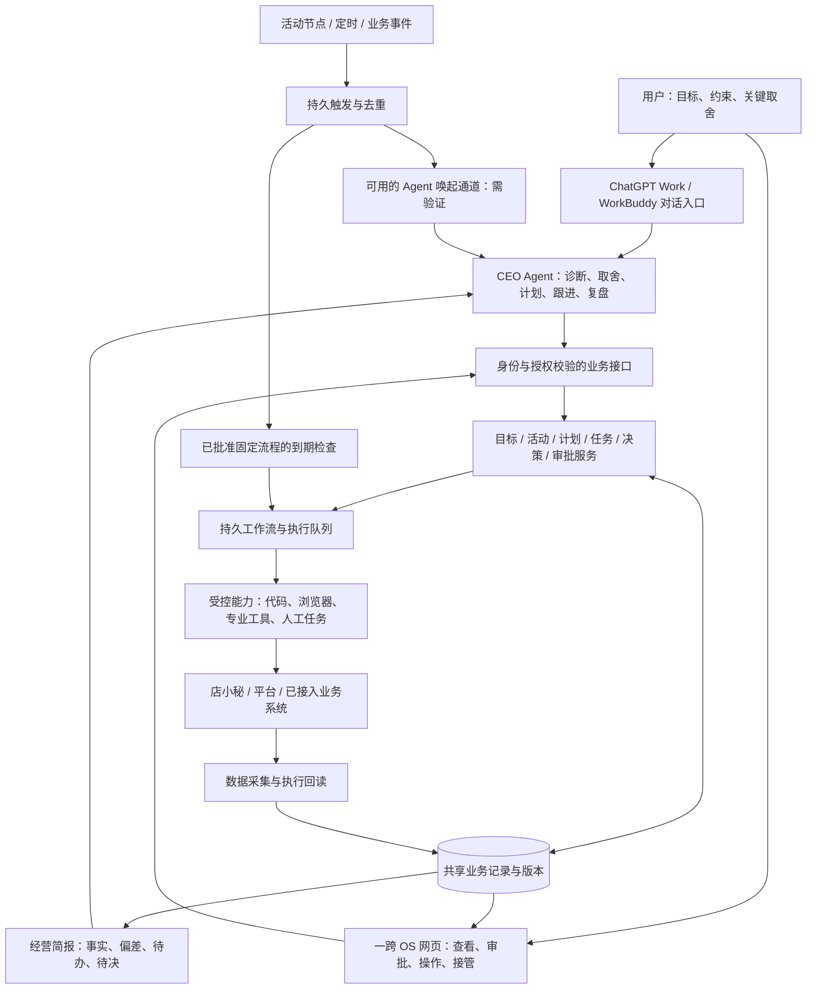

# CEO Agent × 一跨 OS 总体业务蓝图

版本：v0.1 · 2026-10-25 · 待用户审定。

2026-10-26 补充：用户已认可定位、CEO 职责和对话/OS 交互方向，并授权编写 [详细闭环方案](./2026-10-26-ceo-os-operating-loop-design.md)。该稿吸收已收到的 WorkBuddy 回执与评审，补充经营取舍、效果验收、既有菜单与定时能力资料。本文保留历史核对时间；涉及回执、连接和口径的最新结论以详细闭环稿为准。未据此批准产品代码实施。

本文是总体设计，不是开发计划、上线许可或真实经营任务。用户已确认产品定位、主动经营方向，以及按目标和平台活动节奏推进每日任务；本文新增的机制与边界均为设计建议。文末列出需要业务初始化的信息，不要求现在从零补齐。

## 1. 目标与成功标准

服务用户的电商 OPC：用户通过 ChatGPT Work / WorkBuddy 与 CEO Agent 对话管理店铺；CEO Agent 组织经营工作；一跨 OS 承载持久业务记录、显性化工作流和人工操作。

核心目标：**根据经营目标与平台活动周期安排运营节奏，拆出每日可执行任务，持续跟进每一步，使日常行动有依据地推进最终目标。**

验收不能只看回答是否像 CEO：必须能从目标追到阶段计划、今天的任务、执行记录和结果；遇到缺数据、审批等待、失败、离线、人工介入时，明确谁接手、怎样恢复。业务效果与执行完成分别判断，不保证任务全做完必然达到收入或利润目标。

### 明确保留

- 用户是经营目标与关键取舍的最终负责人；CEO Agent 可提出建议、主动跟进，但不能自行修改目标、预算上限和授权以制造成功。
- 双入口读取同一业务事实；用户在 OS 的手动操作会影响 Agent 的后续安排。
- Codex 与 WorkBuddy 是共同开发者，按额度接续。开发身份与产品中的经营身份分开管理。
- 继续复用现有 Node/Express、public、SQLite 与已验证业务流程。保留已批准的模型/原生十图路线、商品数据、现有可用入口及回滚版本。

### 初期边界（建议）

先用一个明确店铺、一类经营目标、一场真实活动或一个普通运营周期完成贯通验收。系统对象保留多店铺维度，但不以首期同时覆盖所有平台为验收要求。

不新造完整 ERP、财务核算或多 Agent 部门体系；采购、价格、活动报名、库存等能力按实际需要逐项接入，未实现时安排可追踪的人工任务。已有采购业务保持原规则与数据边界，不因本蓝图自动并入或改写。

## 2. 设计路线与成熟案例

本次用户同意开始的方向：**外部 CEO Agent + 一跨 OS 共享业务与执行底座，渐进补齐。** 用户尚未批准本文具体细节。

| 路线 | 收益与代价 | 本次处理 |
|---|---|---|
| 外部 CEO Agent，OS 管事实/计划/执行/接管 | 符合用户指定入口，复用现有能力；必须验证连接、身份和离线唤起 | 采用为设计方向 |
| OS 内自建常驻 CEO，外部对话只传话 | 常驻调度可控；增加模型服务与两套决策入口的协调成本 | 不作为首期，未来只有用户改变入口约束时再评估 |
| 以聊天记录和浏览器逐步操作维持全流程 | 原型快；持久计划、并发接管和恢复难以保证 | 浏览器可作为个别适配器，不能替代共享业务状态 |

案例取舍来自已核对官方资料，不代表采购建议或本地试用结论：

- Shopify Sidekick + Flow：借鉴对话到具体工作流、后台任务和审核体验；不能推断直接兼容店小秘或 Choice。[Sidekick](https://help.shopify.com/en/manual/ai-powered-tools/sidekick)、[Flow](https://help.shopify.com/en/manual/shopify-flow/reference)。
- 领星 ERP：借鉴商品/库存/采购/分析之间的关联与建议转单据。其补货能力按实际销量、库存、在途及规则组织；不直接复制到不同仓配模式。[补货建议](https://www.lingxing.com/help/article/allPlatformReplenishmentAdvice)。
- Palantir AIP：借鉴业务对象、行动、权限和审计联动；不照搬企业级规模。[官方治理文档](https://www.palantir.com/docs/foundry/aip/ethics-governance)。
- 动态判断与确定工作流组合，是架构方法参照；不证明商业判断正确。[Anthropic 模式说明](https://www.anthropic.com/research/building-effective-agents)。

## 3. 总体关系图

图中接口、调度和任务服务是目标形态，不代表现有产品已接通。首期 OS 不隐藏第二个经营决策模型；规则检查不擅自代替 CEO 改变策略。若外部入口不可唤起，待决事件可靠积压并显示待接续，不能称为已实现无人值守经营。

## 4. 产品职责与业务范围

| 职责/业务域 | CEO Agent 负责 | 一跨 OS 负责 | 用户介入 |
|---|---|---|---|
| 目标与经营取舍 | 将目标拆解、识别冲突、提出调整建议 | 保存指标定义、版本、范围、约束 | 确认目标和重大调整 |
| 活动与经营节奏 | 倒排工作、安排周期复盘 | 保存有来源的规则/期限、触发提醒与重排检查 | 确认无法可靠获取的信息 |
| 商品经营 | 新品、在售、衰退等阶段的诊断与行动建议 | 商品/店铺/Listing/SKU 映射和证据 | 判断重要商业取舍 |
| 内容与上品 | 选择优化对象、内容策略和优先级 | 已有生成/QC/草稿流程；实际支持的发布流程 | 审批规则要求的版本与动作 |
| 库存与履约 | 识别供给约束、形成调查或处理任务 | 调用已接入能力，保留实际单据/结果 | 未接入或超授权动作 |
| 价格、促销与活动 | 比较方案、判断是否值得尝试 | 仅执行已实现、已授权且可核验动作 | 授权内外的界限按策略执行 |
| 每日工作管理 | 确定重点、安排资源、解除阻塞 | 持久任务、依赖、截止时间、容量、接管记录 | 完成人工任务或重要裁决 |
| 效果复盘 | 检验假设、提出继续/调整/停止 | 保存基线、动作、观察期和结果 | 决定重大策略变化 |

保留增长、利润、现金、风险和时间等不同目标类型；具体首期目标由真实经营资料初始化。缺失成本或现金数据时只给相应限制下的结论，不把估计当已知利润。

## 5. CEO Agent 的经营循环

### 5.1 每次开始前读什么

读取经营纲要与目标版本、店铺与商品范围、最新活动规则、事实摘要及新鲜度、当前计划/未完成任务、上次决策与待验证假设、授权和资源约束。首轮按需补读原始证据，不把整个历史塞进对话。

OS 提供简报与证据链接，CEO 的聊天摘要不是唯一事实来源。入口切换后重读共享记录，不仅转发上一段聊天。

### 5.2 怎样决定下一步

1. 先核对事实时间、口径、主体和完整性；不足则安排补证或明确不可判断。
2. 比较实际与目标/活动节点，发现机会、偏差和即将到期事项。
3. 区分事实与原因假设，优先检查可能导致错误行动的关键假设。
4. 比较采取行动、继续调查、暂缓与停止等选项；说明依据、代价和不确定性。
5. 优先满足硬期限与已确认约束，再按目标贡献、紧迫性、证据可信度、投入与依赖安排工作；不伪造精确收益分数。
6. 形成版本化决策记录与计划差异；范围内的日常重排可执行，改变目标/授权/总预算等需用户决定。
7. 经 OS 检查授权、能力可用性和资源后执行，跟进直到实际核验或明确阻塞。
8. 到观察期检查经营效果；产出可追溯的继续、调整或停止决定。

没有实质变化时结束本次循环，不重复建单或刷屏。单次循环和任务有次数、时长与资源上限，具体值在后续计划按场景配置。

### 5.3 工作节奏

- 日常：形成今日安排，跟进重要节点，日终核对未完成项和明日安排。
- 周期：比较行动效果与目标差距，调整未来计划。
- 活动：根据已确认阶段及截止时间倒排，不硬编码平台日历。
- 事件：重要规则变化、任务失败、审批到达、供给异常或目标变化触发一次有界评估。

频率、时区和免打扰策略在业务初始化时设置。实时状态变化由 OS 记录；不要求 CEO 模型持续轮询每一个字段。

## 6. 核心业务对象与唯一记录

以下是逻辑对象，不要求每项都新建一张表。后续开发计划确定具体存储；现阶段建议新迁入的业务事务复用 SQLite，原始事实和文件产物保留现有合适载体。

| 对象 | 必要信息与关系 |
|---|---|
| 经营目标 Goal | 店铺/商品范围、指标及口径、基线、目标值、时间窗、约束、确认者、版本 |
| 活动/经营日历 Calendar | 平台、店铺、阶段、资格/规则、截止时间与时区、来源、核实时间、版本；报名状态单独记录 |
| 决策 Decision | 关联目标、事实引用、假设、备选、选择理由、资源影响、授权依据、复盘时间 |
| 计划 Plan / Milestone | 目标与日历版本、阶段结果、依赖、容量、承诺期限、版本及调整原因 |
| 任务 Task | 目标或经营保障责任、对象、动作、输入版本、负责人、依赖、期限、预估耗时、验收、失败处理 |
| 执行 Run / Attempt | 任务、能力版本、执行者、资源占用、检查点、操作唯一标识、外部对象、回执与结果 |
| 审批 Approval | 具体动作、店铺/对象、输入版本/内容摘要、授权人、范围、期限、撤销状态 |
| 事实/产物 Evidence | 来源、观察时间、统计窗口、口径、覆盖度、文件/外部引用、哈希及缺失原因 |
| 复盘 Review | 关联目标/决策/动作、基线与观察窗口、结果、干扰因素、结论强度、下一动作 |

两个状态面分开：任务“执行完成”与经营结果“待观察/改善/未改善/证据不足”。外部调用结果未知属于执行核验状态，不可用 success=false 后自动重试来掩盖。

状态原则：业务任务可采用草稿、就绪、执行中、受阻、待核验、完成、失败、取消；受阻区分等人、等数据、等依赖、等资源。映射到 F1 WorkUnit 展示时保留原因与原始状态，不强制所有旧流程立即改成一个枚举。

每个域和流程只有一个权威写入者。旧流程迁移前仍以原存储为准；新任务服务与旧引擎以稳定 ID 关联，F1 只是只读展示。禁止长期双向双写，也不把 .agent/STATE.json 开发交接槽位当经营任务数据库。

## 7. 每日计划与最小可执行任务

### 排程规则

- 每个任务追到目标或必要的经营保障责任；每次活动、对象和计划版本生成稳定标识以避免重复创建。
- 先排硬截止、执行前置和不可拖延的保障任务，再排目标推进；可延后工作留在待办而不是无限塞进今天。
- 检查人、浏览器会话、店铺写入与长时间生成任务的资源冲突。预估超过容量时显示无法按期完成，并给出取舍建议。
- 计划变化比较差异；不默默改变已经承诺的截止时间。过期活动不通过“改日期”继续提交。
- 每日计划保留版本：初始承诺、实际完成、调整原因均可回看。

### 任务卡示例（虚构，仅说明粒度）

对象：店铺 S 的商品 A；目标：活动前完成候选商品可参与性核对。

动作：读取活动规则及商品当前状态，核对资格、资料与履约约束，形成通过项和缺口清单。

输入：已核实的活动版本 C2、商品映射、最新库存/状态证据。期限：实际报名截止前的准备节点，由真实规则及依赖倒排，本文不填日期。

执行者：已授权的只读采集与检查流程；不具备接口时转为明确的人工核对任务。

验收：有规则来源、商品对应证据、每项结论及待确认信息；“打开过页面”不算完成。缺数据则受阻并指明补充方式，不能虚构符合资格。

后继任务：只有通过必要前置，才进入资料准备或申请审批；生成建议本身不触发报名。

## 8. 授权、人工接管与并发控制

### 授权机制建议

查询、分析、本地生成和计划调整也受店铺范围、数据权限、调用预算约束。写平台草稿、报名、改价、采购、发布或删除等按具体动作及已确认授权执行，不把本文视为新授权。既有明确授权无需重复申请，但应保存范围和依据；授权不明确的动作等待决定。

审批绑定店铺、对象、动作和输入版本。更换商品、价格、内容版本或关键活动规则后，旧审批不能自动沿用。用户没有回复只代表等待；注册能力不等于允许调用。原 F2 草案中的“10 行自动放行”仍未获此蓝图认可。

### 接管流程

1. 用户从 OS 请求接管，停止派发该对象的新动作。
2. 正在进行的操作在安全检查点停止；已提交的外部动作先核对结果，不假装能够撤回。
3. OS 确认释放执行占用后允许手动任务接续；急停可立即停止后续调度，但已在外部发生的效果仍需核验。
4. 人工完成后登记结果与证据；仅勾选完成不足以自动认定外部成功。
5. Agent 重读状态，校验前置与版本，再继续下一步。

同一店铺/对象有冲突的动作只允许一个执行者。建议以有限期占用、版本检查和唯一操作标识落实；旧入口需纳入相同控制，否则不能宣称全面防冲突。两个经营入口可以读取，但计划更新须检查版本；交接后旧入口不能继续拿过期身份写入。

## 9. 主动运行与外部入口可行性

OS 需要保存未来节点、事件和待办；CEO 负责经营判断，两者不能混为一谈。ChatGPT Work / WorkBuddy 的连接与后台唤起能力目前未完成验证。

设计前置验证清单（不在本轮执行）：

- 是否能通过当前可用且经授权的连接，从对话读取状态、提交版本化任务、取回结果；具体选官方工具连接、MCP 或 API 适配后定。
- 当前机器上的本地 OS 如何被入口安全访问；不默认公网裸露，也不默认两种入口具有同样连接能力。
- 关闭聊天、额度不足、电脑休眠、模型不可用时，事件能否可靠保留；是否存在受支持的自动唤起与通知渠道。
- 能否在恢复后按事件标识去重，避免重复创建、重复写平台。

验收分为两档：

1. 对话在线时可贯通、离线事件能保留且恢复可接续：只可称“可接续经营”。
2. 已验证可靠唤起、无人发消息也能完成授权内循环，并能升级异常：才能称“主动经营”。

若第二档不支持，保留目标但明确未达标；不能私自引入独立常驻模型来冒充用户指定入口。是否新增执行宿主，需要后续比较并经用户决定。OS 可继续已批准的确定性任务，不新增经营策略。

## 10. 完整场景推演：阶段目标 × 平台活动

下面以店铺 S、商品候选集合 A 和活动 C 表示，不使用虚构官方日期、资格、销量或预算。

| 环节 | 输入与判断 | OS 中的产出/执行 | 核验与下一步 |
|---|---|---|---|
| 1 目标确认 | 用户目标、基线、约束 | Goal v1；缺值明确列待补 | 未确认目标不生成有后果的执行承诺 |
| 2 活动核实 | 官方/授权后台规则、店铺实际资格、时间 | Calendar C1 与证据 | 来源/时区/有效期明确，未知转核对任务 |
| 3 商品筛选 | 目标、销量、供给、内容、资格 | Decision D1，候选与排除理由 | 数据不足不能写成通过 |
| 4 倒排计划 | 截止时间、准备工作、审批与资源容量 | Plan P1，阶段节点与依赖 | 来不及时给出减范围/替代/放弃建议，由授权边界决定 |
| 5 每日安排 | 就绪任务、硬期限、可用资源 | 今日任务与负责人 | 不把受阻任务算成今日可完成承诺 |
| 6 准备与检查 | 商品事实、已有素材及缺口 | 现有内容生成/QC/草稿工作流 | 保存产物版本与质量证据 |
| 7 审批与操作 | 完整准备结果、动作范围 | 具体版本审批；能力存在则执行，否则人工任务 | 平台状态回读，区分已提交、待审核、通过、拒绝 |
| 8 活动跟进 | 实际平台状态与经营变化 | 异常/机会任务与计划调整 | 同一问题复用任务；重大取舍提交用户 |
| 9 结束复盘 | 真实结果、投入、基线、其他影响 | Review R1，效果判断与证据强度 | 得出继续/调整/停止建议，进入下一周期 |

### 关键异常路径

| 事件 | 应有行为 | 禁止的假完成 |
|---|---|---|
| 活动截止或规则改变 | 保存新版本，分析受影响计划与审批；暂停已不适用动作 | 静默沿用过期条件 |
| 数据过期/商品映射不明确 | 阻塞依赖判断，生成补证任务，其余不相关任务可继续 | 用旧值或相似商品代替 |
| 人工审批迟到 | 保留等待，提示对截止的影响并提出替代方案 | 到点自动通过 |
| 外部提交超时 | 标为结果未知，先查询实际平台结果；无法确认则人工核对 | 立即重复提交 |
| 登录失效或服务重启 | 保存检查点，恢复后先核验外部效果，再执行下一步 | 直接从头重跑 |
| 用户手动完成 | 读取人工证据、核对实际状态、更新依赖 | Agent 再执行一遍 |
| 两个入口同时派任务 | 稳定任务键去重，版本冲突返回最新状态供重读 | 两份计划互相覆盖 |
| 目标临时调整 | 新版本及影响分析；未执行任务重排，已发生动作保留记录 | 删除旧目标及失败记录 |
| 入口不可用/额度耗尽 | 保留简报、决策、任务和待唤起事件；显式待接续 | 宣称另一入口已经自动接班 |

## 11. OS 的可视化与人工操作边界

信息结构建议为五个视角，复用现有网页布局，不要求本轮另造整站：

1. 经营总览：目标、实际、差距、证据更新时间和最重要事项。
2. 经营日历：活动节点、阶段计划、硬截止和容量冲突。
3. 今日执行：就绪、执行中、受阻、待核验、完成，点击可见任务证据。
4. 待你决定：问题、备选、影响、截止、具体版本与审批范围。
5. 决策与复盘：当时依据、选择理由、执行结果、效果观察与后续安排。

这里只定义信息与操作职责，不是 UI 视觉稿。对话引用相同对象 ID/版本；聊天中说“完成”的任务必须能在网页找到相应证据。网页不能仅显示模型生成的汇报文本。

## 12. 现状差距与复用策略

证据范围：2026-10-25 本轮静态读码与文件检查；未重跑业务、未访问平台。历史测试单独标注，不能算本轮结果。

| 能力 | 本轮代码/文件证据 | 结论与处理 |
|---|---|---|
| 系统状态总账 | `dist/src/system-state.js`，server 的 GET /api/system/state，public 中 systemLedgerPanel | 已有只读聚合与页面；复用展示基础，不视为统一写任务引擎 |
| 店铺/商品经营对象 | `dist/src/operation-service.js` 的 profile、store、listing、SKU mapping、snapshot、action | 复用对象及映射；字段存在不证明经营闭环已接通 |
| 经营目标 | 同文件 current_operation_goal、current_strategy、next_review_at 为现有字段 | 可迁移历史内容；尚不足以表达指标、约束、版本化目标与计划依赖 |
| 任务接口 | POST /api/operations/tasks 调用 createDataCollectionTask | 是采集任务，不是通用经营任务；不得直接改名声称完成每日执行体系 |
| 经营数据 | scripts 中 metrics-store、fetch-ae-metrics、recompute-metrics 等存在 | 可评估包装现有采集/计算；本轮未核实最新数据或历史全部脚本结果 |
| 能力注册表 | docs/CAPABILITY_REGISTRY_DRAFT.md 存在；config/capabilities.json 与 dist/src/capability-registry.js 本轮不存在 | 仍为草案。逐项按真实副作用/支持范围/验证状态审定，不能沿用“11项完全就绪”作为验收 |
| 网页秘书 | server POST /api/secretary/chat 的注释及实现只生成 command 草稿 | 可复用意图解析或兼容入口，不具备 CEO 的排程和持续跟进 |
| Listing 工作区 | charm-listing-workspace-service.js 的 draftFromFacts 为本地拼接，requestPublish 留 PENDING_OPERATOR | 复用 SQLite/版本/事件模式；不能把 queued 标签当生成已排队，也不能把 PUBLISHING 当已发布 |
| 生成与店小秘流程 | 已有 automation 与 adapters，原目录有他方未提交改动 | 保留并逐项验证；真实外部回读、统一权限/幂等/恢复仍需验收 |
| 持久化修复 | 隔离分支 35291d8 的阶段报告；原目录 HEAD 6e7914b | 已有可靠性工作可集成；第二阶段尚未合入原目录，禁止整目录覆盖 |
| 日历/计划/主动 CEO | 本轮目标文件与路由检索未确认完整实现 | 按缺口设计并做连接验证，不根据需求文档假定可用 |
| 开发交接 | docs/coordination 与 .agent 队列 | 仅是交接基础；未核实 WorkBuddy 已读回执，自动额度接续未验证 |

历史验证：隔离第二阶段报告记录可靠性测试 75/75，完整测试 188/212、24 个既有失败。此处仅引用历史证据；不宣称当前原目录测试通过。

原目录存在 server/public/浏览器适配器等未提交改动；本次不覆盖、不合并、不提交这些代码。已存在的私有回滚版本不等于这些新改动已经备份。

## 13. 三类闭环与验收场景

总体框架先规定交界，详细开发闭环与任务计划留到本文审定后。

- 经营闭环：目标 → 日历/事实 → 决策 → 计划/任务 → 授权执行 → 回读 → 效果复盘 → 下一轮。
- 运维闭环：发现失败/离线/数据异常 → 留痕与分级 → 有界恢复或人工接管 → 核验 → 恢复业务；不能以无限重试替代处置。
- 开发闭环：需求/设计版本 → 单任务认领与边界 → 实现/检查 → 独立审查 → 可回滚交付 → 验收 → 更新交接。额度切换转移同一任务，不另开重复需求。

| 编号 | 必须演示的验收 | 可检查证据 |
|---|---|---|
| A1 | 一个目标能追到今日任务和执行结果 | 相同 goal/plan/task/run 引用与证据 |
| A2 | 活动变更使受影响计划重新评估 | 规则版本、差异、调整记录与过期动作被阻止 |
| A3 | 超容量或依赖未完成不会假承诺 | 冲突说明、优先级和受阻原因 |
| A4 | 对话与网页显示一致 | 相同对象版本、状态和结果链接 |
| A5 | 人工接管后 Agent 不重复操作 | 停止记录、人工回执、新版本接续 |
| A6 | 重复提交/两个入口竞争只执行一次有效动作 | 去重、占用与版本冲突证据 |
| A7 | 超时结果未知先核对而非重试 | UNKNOWN 到核验终态的记录 |
| A8 | 退出入口、重启服务后可接续 | 保存的检查点与恢复记录；自动唤起另验 |
| A9 | 范围外动作、过期审批和未知能力无法执行 | 服务端拒绝记录，旧入口也有对应控制 |
| A10 | 任务完成不会被自动算成经营成功 | 分开的执行状态、效果观察期和复盘结论 |
| A11 | 更换 Work/WorkBuddy 能恢复经营上下文 | 从共享简报重读，未依赖原聊天私有记忆 |
| A12 | 真实主动经营，而非仅手动接续 | 无用户消息时由已验证唤起通道完成授权内循环；若未通过明确标缺口 |

A1–A11 可先用隔离数据和替身执行验证机制，再以真实授权范围试运行；A12 必须验证实际入口。正式发布、付款等不因测试计划获得授权。每项附真实日志/回执，不用示例截图冒充通过。

## 14. 分期边界与待确认

这是依赖顺序，不是工期或任务开发计划：先核对外部入口连接与接续能力、备份并整合可复用基础；再贯通目标/日历/每日任务的一个场景；再补可靠执行与人工接管；最终验证主动运行和经营效果复盘。可以在模拟场景设计期间并行补齐业务信息，但不能以模拟通过替代真实连接。

### 本蓝图可先采用的设计判断

- 首期一个对外负责的 CEO 角色；专业能力用现有工具/流程承接，不先建部门 Agent。
- OS 保存共享经营上下文，外部对话负责判断；一个业务对象只有一套权威记录。
- 渐进迁移、一个场景贯通，保留旧功能；先验证能力再自动化。
- 真实业务初始化再指定首店、实际目标值、活动日期、资源额度和通知策略。本稿用占位符设计，不擅自编造这些事实。

### 进入真实试运行前必须有的信息

目标/基线/统计口径、店铺/商品范围、活动证据、用户可投入时间、授权边界、可用连接与唤起渠道。优先从现有资料读取，再只向用户询问缺失的关键值。

### 失败即不可验收

只有报表没有推进；只有任务清单没有执行核验；跨入口看见不同状态；手动操作后重复执行；把接口存在写成业务已跑通；把无唤起能力的方案称为无人值守；为凑完成率改目标或掩盖失败。

## 15. 本次交付记录

- 本次完成：本蓝图、关系图、正常与异常场景、现状差距及验收矩阵。
- 修改范围：设计/协调文档；不修改产品代码，不重启、不发布、不写平台。
- 验证方式：静态读码和文件检查、文档完整性核对及独立设计审阅；不运行业务测试。
- Backlog：蓝图审定后，编写详细闭环方案与开发计划；不从本稿自动派发开发任务。

### 实际文档检查记录

- 2026-10-25：检查 15 个章节、12 项验收场景、Markdown 围栏配对及待审定标记，全部存在。
- 独立设计审阅：`upgrade_design_check` 依据最新蓝图与定位做只读审阅，返回 `nothing important left`。由于新审阅线程数量已满，复用已有独立审阅线程，并明确要求不沿用旧结论；不是新建的空白上下文审阅。
- 审阅结论仅表示没有发现阻止制定后续计划的关键设计问题，不证明真实连接、主动运行、业务正确性或代码质量已经通过验收。
- 真实店铺、目标值、活动规则、资源额度与授权细则仍需业务初始化；这些不妨碍审议结构，但会阻止对应真实操作上线。

本文件已完成设计审阅，交给用户决定。未审定前不得作为已批准需求进入实施。
